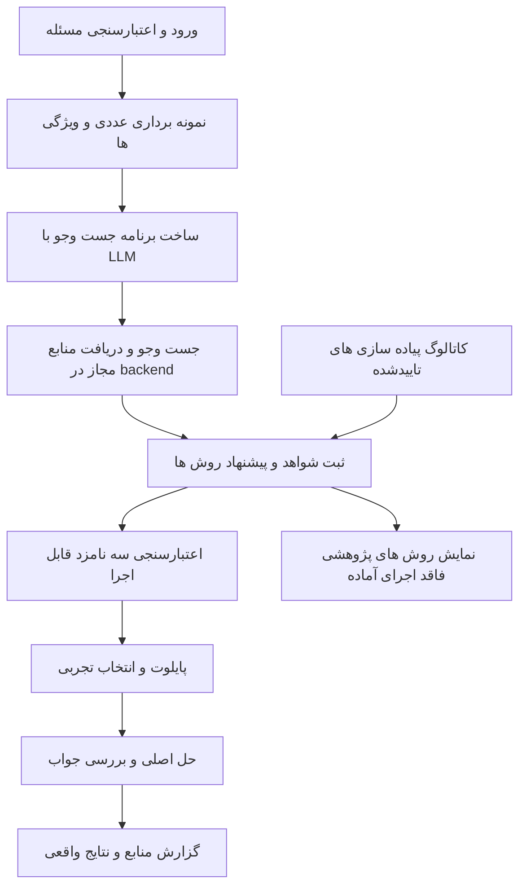

# سند توسعه SolverScout برای پژوهش وب و انتخاب الگوریتم بهینه‌سازی نسخه ۲

| مشخصه | مقدار |
| --- | --- |
| نسخهٔ سند | `2.0` |
| تاریخ تدوین | `2026-11-09` |
| وضعیت | قرارداد پیشنهادی توسعه و معیار پذیرش نسخهٔ بعد |
| مخاطب | توسعه‌دهنده، عامل پیاده‌سازی و ارزیاب پروژه |
| پروژه | SolverScout با نام پیشین P_MC |
| مبنا | `P_MC_Optimization_Agent_Development_Spec_v1.0.md` و پیاده‌سازی محلی نسخهٔ ۱ |
| خروجی مورد انتظار | برنامهٔ محلی با پژوهش وب در منابع منتخب کاربر، پیشنهاد مستند و آزمون عددی الگوریتم‌های قابل اجرا |

## ۱ هدف محصول

کاربر مسئلهٔ بهینه‌سازی را وارد می‌کند. سامانه ویژگی‌های مسئله را استخراج می‌کند، با کمک مدل زبانی پرس‌وجو می‌سازد، در منابع مجاز وب شواهد مرتبط را می‌خواند و چند الگوریتم مناسب را پیشنهاد می‌دهد. پیاده‌سازی‌های سازگار و آزموده‌شده وارد پایلوت عددی می‌شوند. انتخاب روش اجرای اصلی با اندازه‌گیری واقعی انجام می‌شود و گزارش، شواهد اینترنتی و نتایج عددی را جداگانه نشان می‌دهد.

MEALPY یکی از تأمین‌کنندگان پیاده‌سازی است. منبع دانش می‌تواند مستندات رسمی، مقالهٔ اصلی، گزارش بنچمارک یا مخزن کد مشخص باشد. هیچ کتابخانه یا مجموعهٔ منابعی به‌عنوان پوشش تمام الگوریتم‌های دنیا معرفی نمی‌شود.

جست‌وجو هنگام درخواست کاربر انجام می‌شود و نتیجهٔ آن همراه با زمان و نسخه ثبت می‌شود. تازه‌بودن مقاله به‌تنهایی دلیل برتری روش نیست. نامزد نهایی باید هم با مسئله سازگار باشد و هم پیاده‌سازی قابل اجرای مشخص داشته باشد.

واژهٔ «باید» در این سند الزام پذیرش است. تصمیم‌های نسخهٔ نخست این توسعه، از جمله سقف‌ها و نام قراردادها، مشخص‌اند؛ تغییر آن‌ها باید با نسخه و دلیل ثبت شود. نوشتن این سند به معنی پیاده‌شدن یا قبولی آزمون‌های نسخهٔ ۲ نیست.

## ۲ رابطه با نسخهٔ اول

سند نسخهٔ اول صریحاً چهار روش ثابت، سه نامزد در سیاست مشاور و عدم استفاده از تاریخچهٔ اجراها برای انتخاب را تعیین کرده بود. نسخهٔ ۲ دامنهٔ کشف روش و منابع تصمیم را گسترش می‌دهد و قرارداد عددی مشترک را حفظ می‌کند.

| موضوع | قرارداد نسخهٔ ۱ | قرارداد این توسعه |
| --- | --- | --- |
| سبد روش‌ها | چهار ID ثابت در `continuous_v1` | حفظ سبد قدیمی و افزودن `continuous_catalog_v2` |
| دانش مشاور | مسئله، profile و چهار کارت | همان داده‌های مجاز به‌علاوهٔ شواهد بازیابی‌شده و کارت‌های کاتالوگ |
| جست‌وجوی وب | ندارد | مرحلهٔ مستقل و محدود با منابع منتخب کاربر |
| اجرای الگوریتم | چهار نگاشت ثابت MEALPY | کشف کلاس‌ها و اتصال کتابخانه‌ای، سپس تأیید هر پیکربندی |
| انتخاب اصلی | اندازه‌گیری پایلوت | همان انتخاب تجربی و قواعد اعتبار |
| ورودی عددی | پیوسته، قطعی و تک‌هدفه | همان دامنه در نخستین انتشار نسخهٔ ۲ |
| تاریخچهٔ Jobهای قبلی | برای بازبینی | همچنان برای بازبینی؛ آموزش و انتخاب مبتنی بر تاریخچه خارج از این انتشار |
| LLM | API با JSON | همان رابط، با نقش جدید برنامه‌ریز جست‌وجو |

قواعد `policy_version=1.0`، schemaهای نسخهٔ ۱، IDها، seedها و معنای گزارش قدیمی باید حفظ شوند. نسخهٔ `ProblemInput`، DSL و evaluator تا وقتی قرارداد ریاضی آن‌ها تغییر نکرده است همان نسخهٔ ۱ می‌ماند؛ policy، context، plan، Trial envelope و گزارش جدید نسخهٔ ۲ می‌گیرند. `pilot_only` قدیمی همچنان چهار روش را آزمایش می‌کند؛ گسترش کاتالوگ نباید آن را به آزمایش صدها روش تبدیل کند. نسخهٔ جدید نباید فایل‌های گزارش قدیمی را بازنویسی کند.

مرجع اولیه با نام `P_MC_Optimization_Agent_Development_Spec_v1.0.md` بررسی شده است. SHA-256 آن `5ad19a1235e5c9c0fdc224bb76be19f6bd856eec032b39024229fa1b4a19e179` است. این سند اولیه مرجع تدوین است و نباید وابستگی زمان اجرای برنامه باشد.

## ۳ دامنه انتشار نخست

### ۳٫۱ قابلیت‌های الزامی

- اجرای UI، API، پایگاه داده، استخراج متن و موتور عددی روی رایانهٔ کاربر.
- استفاده از مدل زبانی از طریق API و حفظ پشتیبانی سرویس سفارشی سازگار با رابط فعلی.
- تنظیم جداگانهٔ ارائه‌دهنده، کلید و آزمون اتصال مدل و جست‌وجو در UI.
- مدیریت منابع مجاز در سطح hostname و مسیر؛ اعمال محدودیت در backend.
- یک adapter واقعی جست‌وجو برای Tavily، پشت قرارداد مستقل از ارائه‌دهنده؛ آزمون زندهٔ آن شرط تأیید مسیر آنلاین است.
- دریافت و استخراج محتوای HTML، متن ساده و PDF دارای متن، با سقف اندازه و زمان.
- ثبت منبع، سطح دسترسی به متن، تاریخ‌های موجود، زمان دریافت، قطعهٔ شاهد و hash.
- کشف روش‌های نسخهٔ نصب‌شدهٔ MEALPY و نمایش وضعیت واقعی سازگاری آن‌ها.
- پایلوت روی سه پیاده‌سازی تأییدشده با پیکربندی ثابت و سه تکرار برای هرکدام.
- نمایش مستقل روش‌های پژوهشی پیدا‌شده که هنوز امکان اجرای آن‌ها فراهم نیست.
- گزارش مستقل و قابل خواندن آفلاین، همراه با محدودیت‌های واقعی جست‌وجو و اجرا.

### ۳٫۲ موارد خارج از این انتشار

حل چندهدفه، متغیر گسسته، قیود عمومی، تابع تصادفی، tuning خودکار پارامترها، تولید و اجرای کد از مقاله، نصب خودکار وابستگی از نتیجهٔ وب، ورود به سایت نیازمند حساب، دورزدن paywall، مرورگر خودکار برای سایت‌های JavaScript-only، OCR، آموزش مدل از تاریخچه و اجرای همهٔ الگوریتم‌های کاتالوگ برای هر مسئله خارج از این انتشار هستند.

اتصال عددی کتابخانهٔ دوم و adapter اختصاصی API منابعی مانند arXiv توسعه‌های بعدی‌اند. طراحی باید آن‌ها را ممکن کند؛ قبولی این نسخه به پیاده‌سازی آن‌ها وابسته نیست. جست‌وجو و خواندن صفحات عمومی منابع مجاز از همان adapter وب اولیه انجام می‌شود.

## ۴ اصول غیرقابل تغییر موتور عددی

1. دامنهٔ مسئله شامل ۲ تا ۳۰ متغیر حقیقی، کران‌های متناهی، تابع قطعی تک‌هدفه و بدون قید عمومی است. وب یا LLM اجازهٔ تغییر این دامنه در حین Job را ندارد.
2. تابع هدف فقط از مسیر DSL یا تابع ثبت‌شدهٔ برنامه اجرا می‌شود. متن صفحه، قطعه‌کد مقاله و خروجی مدل ورودی اجرایی نیستند.
3. تمام فراخوانی‌های واقعی تابع، شامل initialization و probe کتابخانه، از `BudgetedEvaluator` عبور می‌کنند و FE مصرف می‌کنند.
4. تابع هدف محلی می‌ماند. worker عددی کلید مدل، کلید جست‌وجو یا token داخلی backend را دریافت نمی‌کند.
5. آرشیو ارزیابی‌های ثبت‌شده منبع جواب است. مقدار گزارش‌شدهٔ کتابخانه یا LLM به‌تنهایی شاهد نتیجه نیست.
6. جهت maximize با امتیاز مرکزی برای کمینه‌سازی مدیریت می‌شود؛ مقدار هدف خام در گزارش جهت اصلی را دارد.
7. seed، نسخهٔ کتابخانه، adapter، پارامترها و سیاست اصلاح کران برای هر Trial ثابت و ثبت‌شده‌اند.
8. اجرای اصلی از ابتدا شروع می‌شود. دو ارزیابی تازه برای بررسی نهایی حفظ می‌شوند و بهینگی سراسری `not_certified` می‌ماند.
9. نقطهٔ نهایی می‌تواند از profile یا پایلوت آمده باشد. روش منتخب و منشأ نقطهٔ نهایی دو فیلد مستقل هستند.
10. لغو کاربر، timeout، توقف پس از خطای تابع و حسابداری بودجه طبق قرارداد عددی نسخهٔ ۱ باقی می‌مانند.

## ۵ معماری پیشنهادی



مدل نقش برنامه‌ریز و تحلیلگر دارد. backend درخواست شبکه را اجرا می‌کند، منابع را محدود می‌کند، شواهد را ذخیره می‌کند و ورودی معتبر به مدل می‌دهد. این مسیر به native web search یا tool calling ارائه‌دهندهٔ LLM وابسته نیست. افزودن URL به prompt به‌تنهایی اجرای جست‌وجو محسوب نمی‌شود.

| جزء | مسئولیت |
| --- | --- |
| `ResearchPlanner` | تولید JSON پرس‌وجو از ویژگی‌های مجاز مسئله |
| `SearchGateway` | اعتبارسنجی درخواست، سهم تماس، کلید، idempotency و adapter جست‌وجو |
| `SourcePolicy` | تصمیم قطعی دربارهٔ مجازبودن مقصد و مسیر |
| `DocumentFetcher` | دریافت محدود، کنترل redirect و استخراج متن |
| `EvidenceStore` | ذخیرهٔ متن خوانده‌شده، شاهد، تاریخ و hash |
| `KnowledgeCatalog` | روش‌های شناخته‌شده و ادعاهای دارای منشأ |
| `ExecutableCatalog` | پیاده‌سازی‌ها، پیکربندی‌ها و گواهی سازگاری محلی |
| `LibraryAdapter` | کشف، ساخت و اجرای پیاده‌سازی از بستهٔ نصب‌شده |
| `AdvisorV2` | نگاشت شواهد به روش‌ها و پیشنهاد سه پیاده‌سازی مجاز |
| موتور عددی مشترک | ارزیابی واقعی، پایلوت، انتخاب، main و verification |

تماس شبکه فقط از gateway مربوط در backend انجام می‌شود. UI فقط به API محلی متصل است. درخواست مرورگر کاربر به موتور جست‌وجو یا LLM، و ارسال کلید به frontend، مجاز نیست.

## ۶ تنظیمات منابع و خدمات

### ۶٫۱ منبع مجاز

هر `SourceRule` نسخه‌دار شامل فیلدهای زیر است.

| فیلد | نوع و معنا |
| --- | --- |
| `source_id` | ID پایدار منبع؛ حداکثر ۶۴ نویسه |
| `label` | عنوان قابل خواندن در UI |
| `hostname` | hostname دقیق HTTPS پس از نرمال‌سازی IDNA |
| `include_subdomains` | boolean؛ پیش‌فرض false |
| `path_prefixes` | ۱ تا ۲۰ مسیر مجاز با پیشوند قطعه‌بندی‌شده |
| `source_kind` | `official_docs`، `paper_repository`، `code_repository` یا `benchmark_report` |
| `enabled` | boolean |

نمونهٔ کامل یک `SourceRule` معتبر ساختاری، بدون ادعای فعال‌بودن در تنظیمات کاربر

```json
{
  "source_id": "mealpy_repository",
  "label": "مخزن رسمی MEALPY",
  "hostname": "github.com",
  "include_subdomains": false,
  "path_prefixes": ["/thieu1995/mealpy"],
  "source_kind": "code_repository",
  "enabled": true
}
```

برای این نمونه `/thieu1995/mealpy/issues` مجاز و `/thieu1995/mealpy-malicious` نامجاز است. hostname مشابه یا زیر‌دامنه بدون مجوز نیز رد می‌شود. میزبان‌هایی مانند `raw.githubusercontent.com` و endpointهای API مجوز مستقل می‌خواهند.

UI باید افزودن، ویرایش، غیرفعال‌کردن، ورود و خروج JSON منابع را فراهم کند. تغییر فهرست یک revision جدید می‌سازد. snapshot هر Job شامل revision و hash فهرست است. فهرست خالی اجازهٔ اجرای سیاست وب نمی‌دهد.

منابع اولیهٔ پیشنهادی شامل مستندات نسخه‌دار MEALPY، مخزن رسمی آن و صفحات عمومی مقالات در arXiv است. این فهرست باید در UI قابل مشاهده و تغییر باشد. کل `github.com` به‌عنوان منبع علمی قابل اعتماد پیش‌فرض پذیرفته نشود. دامنهٔ مجاز بودن، به‌تنهایی صحت ادعا یا داوری‌شدن مقاله را اثبات نمی‌کند.

### ۶٫۲ ارائه‌دهنده جست‌وجو

`SearchProfile` شامل `profile_id`، `revision`، `provider_id`، endpoint تعریف‌شده در adapter، timeout، سقف‌ها و `credential_ref` است. در انتشار نخست `provider_id=tavily` است. endpoint از متن کاربر، نتیجهٔ وب یا پاسخ LLM انتخاب نمی‌شود.

قرارداد داخلی adapter، مستقل از نام پارامترهای API شرکت است. نگاشت پارامترها و قابلیت محدودسازی دامنه باید در P2 با مستندات رسمی و آزمون واقعی تثبیت شود. نبود قابلیت مورد نیاز، خطای صریح می‌دهد و به جست‌وجوی بدون محدودیت تبدیل نمی‌شود.

کلید جست‌وجو از کلید LLM مستقل است. هر دو از الگوی broker موجود استفاده می‌کنند، با namespace خدمت، credential reference و origin دقیق. پیش‌فرض نگهداری در RAM و ذخیرهٔ دائمی اختیاری فقط در keyring امن سیستم‌عامل است. کلید، header و پاسخ بازتاب‌دهندهٔ secret نباید وارد DB عمومی، لاگ، prompt، PDF، HTML، ZIP یا فرایند عددی شوند.

آزمون اتصال یک عمل صریح UI است، idempotency دارد و احتمال هزینهٔ آن نمایش داده می‌شود. آزمون جست‌وجو باید یک پرس‌وجوی ثابت و غیرحساس در یک منبع مجاز فعال انجام دهد. صفر نتیجه می‌تواند به معنی موفقیت اتصال باشد و به معنی موفقیت پژوهش مسئله نیست.

## ۷ برنامه جست‌وجو و کنترل درخواست

### ۷٫۱ ورودی برنامه‌ریز

`research_planner.v2` فقط `SearchProblemProfile`، منابع فعال و سقف پرس‌وجو را می‌گیرد. profile شامل تعداد متغیر، نوع متغیر، جهت هدف، وجود کران، وضعیت نیاز به مشتق، قطعی‌بودن و برچسب‌های محاسبه‌شده با عدم قطعیت است. از نمونه‌های محدود ادعای اثبات تحدب یا ساختار سراسری ساخته نشود.

متن خام مسئله، فرمول کامل، نام فایل‌ها، نقاط نمونه، جواب مرجع و اطلاعات حساب به موتور جست‌وجو فرستاده نمی‌شوند. برنامه‌ریز نیز برای ساخت query این داده‌ها را دریافت نمی‌کند. ورودی کامل مسئله طبق قرارداد فعلی ممکن است به نقش صورت‌بند یا مشاور LLM برسد؛ مقصدهای مدل و جست‌وجو جدا در UI نمایش داده شوند.

### ۷٫۲ خروجی برنامه‌ریز

خروجی `ResearchQueryPlan` با `extra=forbid` شامل `schema_version=2.0` و آرایهٔ ۱ تا ۳ query است. هر query دارای `query_id`، `text` با طول ۱ تا ۳۰۰ نویسه، `source_ids` غیرخالی و متمایز و `purpose` برابر `method_discovery` یا `implementation_evidence` است. شناسهٔ منبع باید از snapshot آمده باشد. URL اجرایی، header، کد یا دستور نصب در این DTO وجود ندارد.

```json
{
  "schema_version": "2.0",
  "queries": [
    {
      "query_id": "q1",
      "text": "bounded continuous derivative free optimization algorithm comparison",
      "source_ids": ["mealpy_repository"],
      "purpose": "method_discovery"
    }
  ]
}
```

هر `query_id` در plan باید یکتا باشد. backend تکرار را با کلید `(normalized_text, sorted_source_ids, purpose)` حذف می‌کند؛ متن یکسان با محدودهٔ منابع متفاوت دو query مستقل است. نرمال‌سازی متن شامل Unicode NFKC و یکی‌کردن فاصله‌هاست. ترتیب باقی‌مانده حفظ و domain filter از source policy ساخته می‌شود. `site:` داخل query جایگزین کنترل backend نیست. queryای که با `site:` دامنه‌ای بیرون از منابع مجاز را هدف بگیرد رد می‌شود.

نسخهٔ نخست یک دور برنامه‌ریزی و یک دور دریافت دارد. مدل اجازهٔ حلقهٔ جست‌وجوی نامحدود یا افزایش سهم تماس را ندارد. تعداد و متن queryهای واقعی در گزارش ذخیره می‌شوند.

### ۷٫۳ دریافت و استخراج متن

هر نتیجه ابتدا از source policy عبور می‌کند. URL اصلی، URL نهایی، زنجیرهٔ redirect و دلیل رد ثبت می‌شوند. HTTPS روی پورت ۴۴۳، بدون userinfo، تنها طرح مجاز است. fragment حذف می‌شود؛ query string معتبر حفظ می‌شود و پارامترهای tracking شناخته‌شده فقط با قاعدهٔ نسخه‌دار حذف می‌شوند.

مقصد باید IP عمومی داشته باشد. loopback، شبکهٔ خصوصی، link-local، endpoint متادیتا، `file:` و تغییر مقصد DNS یا redirect به این نشانی‌ها رد می‌شوند. پیاده‌سازی باید اعتبارسنجی IP را به اتصال واقعی متصل کند و TLS hostname verification را حفظ کند. همهٔ redirectها دوباره بررسی شوند. credential خدمات API هرگز همراه درخواست صفحه یا redirect ارسال نمی‌شود. دریافت صفحه باید محدودیت دسترسی اعلام‌شدهٔ سرویس را رعایت کند. fetcher با User-Agent مشخص `P_MC_Research/2.0` قبل از دریافت سند، robots همان host را بررسی می‌کند. فقط درخواست `/robots.txt` در همان host، به‌عنوان metadata کنترل دسترسی، از محدودیت path منبع مستثناست و محتوا وارد شواهد نمی‌شود؛ کنترل IP و redirect همچنان اعمال می‌شود. نسخهٔ parser robots باید قفل شود. پاسخ 200 با قواعد مربوط به این user-agent بررسی می‌شود؛ 404/410 به معنی نبود قواعد اعلام‌شده و 401/403 به معنی منع fetch است. timeout، 5xx یا robots غیرقابل پردازش، `SOURCE_POLICY_UNAVAILABLE` می‌دهد و آن host در این اجرا fetch نمی‌شود. robots معتبر حداکثر ۲۴ ساعت cache دارد. دریافت یا redirect آن از سقف مشترک HTTP مصرف می‌کند؛ بنابراین ممکن است کمتر از شش سند دریافت شود. خطای robots به‌عنوان paywall مقاله گزارش نمی‌شود.

HTML بدون اجرای JavaScript استخراج می‌شود. PDF فقط از متن قابل استخراج استفاده می‌کند. PDF اسکن‌شده، متن خالی، قالب ناسازگار، صفحهٔ ورود و paywall با وضعیت روشن ثبت می‌شوند. محدودیت فشرده‌سازی و اندازه روی محتوای بازشده نیز اعمال می‌شود. قطع parser یا timeout نباید worker اصلی را متوقف کند.

snippet موتور جست‌وجو برای کشف اولیه مجاز است. برای توصیهٔ قابل استناد، حداقل متن چکیده، مستندات یا بخش مربوط از مقاله باید واقعاً دریافت شده باشد. UI نباید مشاهدهٔ چکیده را «خواندن مقالهٔ کامل» نمایش دهد.

## ۸ تازگی و حافظهٔ محلی

پیش‌فرض `research_mode=live` است. هر Job جدید در این حالت query واقعی شبکه اجرا می‌کند. برای صفحه‌ای که قبلاً ذخیره شده است، درخواست شرطی با ETag یا Last-Modified مجاز است؛ پاسخ `304` شاهد بازاعتبارسنجی در زمان جدید است. بدون این پاسخ یا دریافت تازه، صفحهٔ cacheشده «تازه دریافت‌شده» محسوب نمی‌شود.

حالت اختیاری `research_mode=cache_only` فقط شواهد ذخیره‌شده را می‌خواند و هیچ تماس جست‌وجو یا fetch ندارد. این حالت ممکن است همچنان برای تحلیل به LLM API نیاز داشته باشد؛ نام «کاملاً آفلاین» برای آن مجاز نیست. `max_cache_age_hours` پیش‌فرض ۲۴ و بازهٔ مجاز ۱ تا ۷۲۰ ساعت است. سن cache از آخرین دریافت یا بازاعتبارسنجی موفق شبکه، یعنی `validated_at`، محاسبه می‌شود؛ پاسخ 304 باید به hash متن ذخیره‌شده متصل باشد. زمان دریافت اولیهٔ bytes در `fetched_at` حفظ می‌شود. خواندن یا کپی cache سن آن را صفر نمی‌کند و timestamp نامعتبر یا در آینده تازه محسوب نمی‌شود. نبود شواهد با عمر مجاز، وضعیت ناکافی ایجاد می‌کند.

برای `live`، سیاست تازگی مقالات `prefer_recent` است. queryها می‌توانند روش‌های جدید را جست‌وجو کنند، اما حذف همهٔ منابع قدیمی الزام نیست. `published_at` و `updated_at` در صورت نامعلوم‌بودن null هستند؛ `fetched_at` همیشه زمان واقعی دریافت است. موتور نباید تاریخ دریافت را به‌عنوان تاریخ انتشار جا بزند.

کلید cache شامل query یا URL canonical، provider، source policy hash، نسخهٔ parser و زبان است. قبل از استفادهٔ cache، مجازبودن منبع تحت policy همان Job دوباره بررسی می‌شود. snapshot قدیمی برای بازبینی گزارش حفظ می‌شود، ولی تغییر منابع نباید دادهٔ ممنوع را وارد Job جدید کند.

متن استخراج‌شده در مخزن محلی نگهداری می‌شود. cache قابل پاک‌کردن است، اما شاهد ارجاع‌شدهٔ Job موجود مستقل و تا حذف صریح همان دادهٔ اجرا حفظ می‌شود. نگهداری raw PDF اختیاری است؛ hash فایل دریافت‌شده و متن مورد استفاده الزامی‌اند. گزارش اشتراک‌پذیر به‌طور پیش‌فرض متن کامل مقاله را بسته‌بندی نمی‌کند.

## ۹ دو کاتالوگ مستقل

### ۹٫۱ کاتالوگ دانش

`MethodRecord` هویت علمی روش را ثبت می‌کند و شامل نام، نام‌های دیگر، خانواده، variant، منابع و ادعاهای دارای شاهد است. هر ادعا وضعیت `supported`، `uncertain` یا `conflicting` و source reference دارد. خروجی LLM یک ادعای استخراج‌شده است و به‌تنهایی متادیتای قطعی سازگاری اجرای روش نیست.

روش جدید می‌تواند وضعیت `known_only` داشته باشد. این روش در نتایج پژوهش نمایش داده می‌شود و تا آماده‌شدن پیاده‌سازی وارد پایلوت نمی‌شود. وجود پیوند GitHub یا عبارت «کد موجود است» به معنی نصب یا آزمون موفق نیست.

دریافت اطلاعات جدید، record قبلی را بی‌ردپا بازنویسی نمی‌کند. شاهد و نسخهٔ جدید اضافه می‌شود و اختلاف منابع قابل مشاهده می‌ماند. مقالهٔ اصلی، مستندات و نتیجهٔ آزمایش خود برنامه، منشأهای جدا دارند.

### ۹٫۲ کاتالوگ اجرا

`ImplementationRecord` دارای ID داخلی پایدار، `method_id` اختیاری، نام بسته و نسخه، module و class کشف‌شده، adapter version، قابلیت‌های تأییدشده، `family_id`، وضعیت و qualification report است. رشتهٔ module/class صرفاً در metadata تولیدشده توسط adapter قرار دارد و از ورودی LLM import نمی‌شود.

چرخهٔ وضعیت شامل `discovered`، `needs_configuration`، `qualified`، `rejected` و `disabled` است. فقط پیکربندی `qualified` در محیط سازگار، قابل انتخاب است. `disabled` شدن برای Job جدید اعمال می‌شود؛ snapshot در حال اجرا بازنویسی نمی‌شود.

شناسهٔ v2 از قالب `{provider_id}:{module_relative_to_package}:{class_name}` ساخته شود؛ نمونهٔ قالب `mealpy:swarm_based.GWO:OriginalGWO` است. نسخهٔ بسته و config در فیلدهای جدا قرار می‌گیرند. کلاس هم‌نام در دو module یک شناسه نمی‌گیرد و این رشته به‌تنهایی مجوز import نیست. نگاشت با چهار ID قدیمی صریح باشد؛ IDهای v1 تغییر نکنند.

کشف اولیه با API کتابخانهٔ نصب‌شده انجام شود. برای MEALPY از `get_all_optimizers(verbose=False)` یا معادل آزموده‌شدهٔ آن استفاده شود. کشف هیچ حل عددی، نصب بسته یا تماس شبکه ایجاد نمی‌کند. تعداد کلاس و تعداد روش علمی، و نیز تعداد پیکربندی تأییدشده، جدا نمایش داده شوند.

در بازبینی محیط مبنا، MEALPY نسخهٔ `3.0.3` تعداد ۲۳۴ کلاس را برگرداند. این یک مشاهدهٔ محیطی است؛ عدد ثابت پذیرش یا ادعای تأیید همهٔ کلاس‌ها نیست.

### ۹٫۳ پیکربندی و افزودن الگوریتم

یک adapter مشترک برای هر کتابخانه، همراه با metadata و overrideهای محدود برای موارد خاص، ساخته شود. افزودن کلاس سازگار در نسخهٔ نصب‌شده نباید به تغییر enum ثابت، UI، prompt، رتبه‌بندی و چند فایل موازی نیاز داشته باشد.

همهٔ پارامترهای مؤثر constructor و اجرای solver باید resolve و snapshot شوند. پیش‌فرض‌های مبهم، callable ناشناخته یا آرگومان‌های غیرقابل استخراج، `needs_configuration` ایجاد می‌کنند. کپی‌کردن کورکورانهٔ `pop_size` و پارامترهای روش دیگر مجاز نیست. تغییر تنظیمات توسط LLM در این انتشار مجاز نیست.

`config_id` به پیکربندی immutable اشاره می‌کند. hash آن از نسخهٔ بسته، adapter، کلاس، پارامترهای canonical، قواعد کران و حالت اجرا ساخته می‌شود. هر تغییر hash، qualification جدید می‌خواهد. تغییر کتابخانه در حین Job انجام نمی‌شود و replay با نسخهٔ ناسازگار خطای صریح دارد.

رابط پیشنهادی adapter شامل `discover()`، `resolve_configuration()`، `capabilities()` و `run(evaluator, trial_snapshot)` است. این نام‌ها قرارداد داخلی جدید هستند و ادعای وجود فعلی آن‌ها نیستند. بسته‌ها فقط از محیط نصب‌شدهٔ مدیریت‌شده شناخته می‌شوند؛ دانلود کد از نتایج پژوهش جزو این رابط نیست.

### ۹٫۴ تأیید سازگاری

qualification باید در فرایند عددی جدا، با seed و بودجهٔ محدود و بدون credential انجام شود. حداقل روی Sphere دوبعدی، Rosenbrock دوبعدی و یک مسئلهٔ ۱۰بعدی جابه‌جا‌شده، حفظ کران، نتیجهٔ متناهی، شمارش FE، توقف بودجه، تکرارپذیری و عدم بلعیدن استثنای کنترل‌شده بررسی شود. آزمون خطا، لغو و دامنه‌های مرزی ۲ و ۳۰بعدی نیز در suite adapter الزامی است.

قبولی قرارداد، ادعای برتری علمی نیست. یک روش که پیش از ۵۰۰ FE توقف ذاتی دارد، ممکن است برای حل مستقل مناسب باشد، ولی برای سیاست پایلوت این نسخه واجد شرایط نیست. قابلیت `pilot_500_compatible` جدا ثبت شود.

اجرای batch qualification فقط با عمل صریح نگهداری کاتالوگ شروع می‌شود. پیش‌نمایش آن تعداد configها، حداکثر FE و زمان را نشان می‌دهد و لغوپذیر است. این هزینه در ledger جدا از Jobهای کاربر ثبت می‌شود. شروع برنامه یا بازکردن UI نباید خودکار صدها آزمون را اجرا کند.

معیار توسعه‌پذیری نخستین انتشار، تأیید حداقل دو پیاده‌سازی افزوده از حداقل یک خانوادهٔ بیرون از چهار روش قدیمی است. افزوده‌شدن آن‌ها باید بدون تغییر هستهٔ workflow و enum روش‌های v2 انجام شود. باقی کلاس‌ها می‌توانند با دلیل روشن در وضعیت کشف‌شده یا ردشده باقی بمانند.

## ۱۰ قراردادهای داده و منشأ

تمام DTOها نسخه‌دار، strict و فاقد فیلد اضافی‌اند. JSON دارای کلید تکراری، NaN و Infinity رد می‌شود. شناسهٔ رویدادها و رکوردها را backend می‌سازد. دادهٔ حاصل از وب در پیام داده قرار می‌گیرد و دستور سیستمی، ابزار یا نقش جدید ایجاد نمی‌کند.

| قرارداد | فیلدهای اصلی و الزام |
| --- | --- |
| `ResearchSnapshot` | policy version، source revision/hash، search profile revision، mode، سقف‌ها، catalog hash و prompt/schema version |
| `SearchRequest` | invocation ID، query ID/text، source IDs و snapshot reference؛ فاقد secret |
| `SearchHit` | URL، عنوان، snippet، provider rank، query ID، تاریخ‌های nullable و نتیجهٔ کنترل منبع |
| `SourceDocument` | source ID، URL درخواست و نهایی، fetched/validated timestamps، content type، سطح متن، parser version، hash bytes و hash متن، fetch status |
| `EvidencePassage` | evidence ID، document ID، متن خوانده‌شده، محل در متن استخراج‌شده و در صورت موجود شمارهٔ صفحه یا عنوان بخش |
| `ResearchMethodCandidate` | نام و variant، ادعاهای شاهددار، uncertainty، implementation match یا null و علت نبود تطابق |
| `SolverCardV2` | implementation/config IDs، family ID، library/adapter versions، قابلیت‌های تأییدشده و snapshot کامل تنظیمات |
| `AdvisorPlanV2` | status برابر ready یا insufficient_evidence، نامزدهای اجرایی، rationale و evidence refs، یافته‌های پژوهشی و reason codes |
| `ResearchOutcome` | status، شمار تماس‌ها، اسناد موفق/ناموفق، هزینهٔ معلوم یا null، evidence snapshot و دلیل افت کیفیت |
| `TrialRequestV2` | قرارداد عددی قبلی به‌علاوهٔ implementation/config/catalog hashes؛ از mapping سروری ساخته شود |

`content_level` یکی از `snippet`، `abstract`، `documentation` یا `full_text` است. `full_text` فقط وقتی صادر شود که متن کامل در دسترس واقعاً استخراج شده باشد. extraction ناقص با فلگ جدا ثبت می‌شود.

شاهد واردشده به مشاور باید به متن ذخیره‌شدهٔ همان Job resolve شود. شناسهٔ منبع ساختگی، شاهد از Job دیگر یا قطعهٔ ناسازگار با hash رد می‌شود. اعتبار نحوی citation کافی نیست؛ پشتیبانی معنایی از ادعا در ارزیابی کیفیت جدا سنجیده می‌شود.

خلاصهٔ حاصل از مدل، منبع مستقل محسوب نمی‌شود و باید به passageهای اصلی اشاره کند. زمان‌ها UTC با offset مشخص و عددها در JSON عددی باشند. هزینهٔ نامعلوم null است؛ صفر ساختگی ثبت نشود.

## ۱۱ فیلتر و تصمیم مشاور

کارت‌های قابل اجرا ابتدا با دامنهٔ قطعی مسئله، قابلیت qualification، نسخهٔ محیط و `pilot_500_compatible` فیلتر می‌شوند. metadata نامعلوم با حدس LLM به «سازگار» تبدیل نشود. هر رد، reason code دارد.

برای جلوگیری از ارسال صدها کارت، shortlist متنی حداکثر ۲۰ کارت ساخته شود. نسخهٔ اول از SQLite FTS و metadata ساخت‌یافته استفاده می‌کند و به vector database یا embedding API نیاز ندارد. رتبهٔ بازیابی، قواعد نرمال‌سازی و tie-break با ID ثابت ثبت شوند. از خانواده‌های سازگار ابتدا یک نماینده وارد شود و سپس ظرفیت باقی‌مانده پر شود؛ فهرست حذف‌ها و دلیل آن قابل بازرسی باشد.

نام‌های یافته‌شده در وب با aliasها و metadata به پیاده‌سازی دقیق نگاشت شوند. هم‌نامی کافی نیست. نگاشت نامطمئن `unmapped` می‌ماند. معرفی مقالهٔ یک variant نباید به نسخهٔ دیگر همان خانواده نسبت داده شود.

`advisor.v2` مسئلهٔ معتبر، profile، حداکثر ۲۰ کارت، evidence passageها و سقف سه نامزد را دریافت می‌کند. خروجی دارای `status` است. در `ready`، آرایهٔ candidates دقیقاً سه جفت متمایز implementation/config از snapshot دارد. در `insufficient_evidence`، آرایهٔ candidates خالی و reason_codes غیرخالی است؛ یافته‌های پژوهشی و ابهام‌ها همچنان قابل ثبت‌اند. همهٔ فیلدها در هر دو حالت موجودند و اعتبارسنجی معنایی رابطهٔ status و طول آرایه را کنترل می‌کند. اعلام صادقانهٔ ناکافی‌بودن شواهد، خطای schema نیست و repair خودکار مصرف نمی‌کند. در نسخهٔ نخست، برای یک implementation بیش از یک config وارد همان پایلوت نشود. الگوریتم حق تغییر تابع، seed، بودجه یا تنظیمات را ندارد.

در حالت وب موفق، هر نامزد حداقل یک شاهد خارجیِ دریافت‌شده دربارهٔ خود روش یا خانوادهٔ صریح آن و حداقل یک ارجاع به کارت اجرای محلی دارد. شاهد خانوادگی با برچسب `family_level` گزارش شود و ادعای مقایسهٔ مستقیم variant از آن استخراج نشود. اگر سه نامزد واجد شواهد فراهم نشدند، نتیجهٔ پژوهش ناکافی است.

در خروجی پژوهشی حداکثر ۱۰ روش خارج از سبد اجرا قابل نمایش‌اند. آن‌ها در تعداد سه نامزد یا رتبه‌بندی پایلوت شمرده نمی‌شوند. «بهترین روش پیدا‌شده در منابع» و «برندهٔ پایلوت این اجرا» عنوان و فیلد مستقل دارند.

## ۱۲ سیاست‌های اجرا و بودجه

### ۱۲٫۱ سیاست‌های جدید

| policy ID | نیاز به پژوهش وب | انتخاب نامزد | k |
| --- | --- | --- | ---: |
| `web_research_then_pilot` | بله، live یا cache_only | مشاور با شواهد وب و کاتالوگ | 3 |
| `catalog_llm_then_pilot` | خیر | همان مشاور با کارت‌های کاتالوگ و profile، بدون شواهد وب | 3 |
| `catalog_fixed` | خیر | implementation/config صریح و تأییدشده | 0 |

این سیاست‌ها `policy_version=2.0` و `portfolio_id=continuous_catalog_v2` دارند. snapshot واقعی کاتالوگ جدا ثبت می‌شود. سیاست‌های نسخهٔ ۱ با semantics قبلی باقی می‌مانند. `catalog_fixed` فقط ورودی ساخت‌یافته و `explain_via_llm=false` می‌پذیرد و هیچ تماس مدل یا جست‌وجو ندارد.

### ۱۲٫۲ بودجه عددی

FE تعداد فراخوانی واقعی تابع هدف است. تماس مدل، جست‌وجو و دریافت مقاله FE نیستند و ledger جدا دارند.

```text
B_main = B_total - 8 - 492 - (k * 3 * 500) - 2
B_main >= 500
k = 3  => B_total >= 5502
k = 0  => B_total >= 1002
B_total = 20000, k = 3 => B_main = 14998
```

برای هر نامزد سه Trial تازهٔ ۵۰۰ FE اجرا می‌شود. شرط اعتبار هر Trial، پایان با `evaluation_budget`، دقیقاً ۵۰۰ ارزیابی شروع‌شده و موفق، صفر شکست، آرشیو معتبر و لاگ کامل است. یک نامزد فقط با اعتبار هر سه تکرار eligible می‌شود. تکرار شکست‌خورده خودکار جایگزین نمی‌شود و سهم مصرف‌نشده به main منتقل نمی‌شود.

برای مشتق‌سازی seed، برچسب نسخهٔ ۱ حفظ شود تا نمونه‌برداری مشترک برای مقایسهٔ سیاست‌ها یکسان بماند. مقدار `seed_identity` در preflight/profile برابر `none` است؛ در pilot/main چهار پیاده‌سازی به‌ارث‌رسیده برابر ID نسخهٔ ۱ آن‌ها و برای هر پیاده‌سازی دیگر برابر `implementation_id` canonical است. این نگاشت صریح، مقایسهٔ v1 و v2 روی همان پیاده‌سازی را با seed یکسان ممکن می‌کند. این identity با تغییر config عوض نمی‌شود و در snapshot ثبت می‌شود.

```text
label = "loa-seed-v1|{master_seed}|{problem_math_hash}|{purpose}|{seed_identity}|{replicate_index}"
child_seed = int.from_bytes(SHA256(label.encode("utf-8")).digest()[:8], "big") % 2**32
```

در pilot شاخص تکرار ۰، ۱ و ۲ و در main صفر است. ترتیب واقعی اجرا بر اساس implementation ID و سپس شاخص تکرار است. شناسهٔ تصادفی Job، زمان، ترتیب پیشنهاد LLM یا hash داخلی Python در seed دخالت ندارند. hash و normalization ریاضی مسئله همان قرارداد نسخهٔ ۱ باقی می‌مانند.

حداقل دو نامزد eligible برای انتخاب تجربی لازم است. ترتیب رتبه‌بندی `(median_score, normalized_iqr, implementation_id)` است. IQR با روش linear روی scoreهای نرمال‌شده با ضریب مشترک `max(1,max(abs(score)))` محاسبه می‌شود. قرارداد float64 و ترتیب اجرای قطعی حفظ شوند. از سه تکرار درصد اطمینان علمی ساخته نشود.

### ۱۲٫۳ سقف‌های پژوهش در انتشار نخست

این جدول پیش‌فرض و سقف سخت backend را مشخص می‌کند. کاربر می‌تواند سقف‌ها را کاهش دهد؛ افزایش بالاتر از ستون آخر به نسخهٔ policy جدید نیاز دارد.

| منبع مصرف | پیش‌فرض | سقف سخت |
| --- | ---: | ---: |
| تماس موتور جست‌وجو در Job با احتساب تلاش دوباره | 3 | 3 |
| query یکتای برنامهٔ جست‌وجو | 3 | 3 |
| نتیجهٔ درخواستی هر query | 5 | 5 |
| document یکتای مجاز برای fetch | 6 | 6 |
| redirect هر document | 3 | 3 |
| مجموع درخواست HTTP جست‌وجو و fetch با احتساب redirect | 27 | 27 |
| timeout هر درخواست جست‌وجو یا fetch | 20 ثانیه | 30 ثانیه |
| کل زمان فعال مرحلهٔ جست‌وجو و استخراج | 120 ثانیه | 180 ثانیه |
| محتوای بازشدهٔ هر سند | 5 MiB | 10 MiB |
| کل محتوای بازشدهٔ اسناد | 20 MiB | 30 MiB |
| متن استخراج‌شدهٔ نگهداری‌شده از هر سند | 60000 نویسه | 100000 نویسه |
| مجموع passageهای وب ارسال‌شده به مشاور | 18000 نویسه | 24000 نویسه |
| کارت اجرای فرستاده‌شده به مشاور | 20 | 20 |

سقف ۲۷ از سه query و شش document با حداکثر چهار hop ساخته شده است. retry خودکار HTTP/SDK خاموش است؛ درخواست شرطی و redirect نیز تماس واقعی شمرده می‌شوند. تلاش دستیِ تازه برای query قبلی هم یکی از سه تماس جست‌وجو را مصرف می‌کند. در انتشار نخست queryها و fetchها به‌صورت ترتیبی اجرا شوند. پس از کنترل منبع، نتایج هر query با رتبهٔ provider و سپس URL canonical مرتب شوند. انتخاب سند به‌صورت نوبتی از query اول تا آخر انجام شود؛ URL canonical تکراری رد و نخستین شش URL یکتا انتخاب شوند. علت حذف یا خارج‌ماندن هر hit ثبت شود. اگر سقف داده یا زمان زودتر تمام شود، تماس تازه آغاز نشود. timeout هر تماس و parser از زمان باقی‌مانده بیشتر نباشد؛ overshoot واقعی cleanup جدا اندازه‌گیری شود. متن ناقص با محل truncation و وضعیت آن ثبت شود. قاعدهٔ اولیهٔ passage با نسخهٔ `passage_selection_v2.0` ثابت شود. متن با مرز پاراگراف به قطعه‌های حداکثر ۱۵۰۰ نویسه تقسیم و قطعهٔ بلند با حفظ offset شکسته شود. keywordها از queryهای همان سند با NFKC، حروف کوچک و جداسازی روی نویسه‌های غیرحرفی/غیرعددی ساخته شوند؛ token یک‌نویسه‌ای حذف شود. امتیاز هر قطعه تعداد keywordهای یکتای منطبق است. از هر سند حداکثر دو قطعه با امتیاز بیشتر و tie-break روی offset کوچک‌تر انتخاب شوند؛ امتیاز صفر با برچسب نبود تطابق متنی مجاز است. قطعه‌ها در ترتیب نوبتی اسناد تا سقف مجموع ارسال شوند؛ آخرین قطعه در صورت نیاز با offset دقیق کوتاه شود. متن ارسالی و offsetها عیناً ذخیره شوند. این امتیاز بازیابی، احتمال مناسب‌بودن علمی روش نیست.

سقف خروجی هر نقش LLM از profile همان Job می‌آید. در v2 چهار نقش `formulator`، `research_planner`، `advisor` و `explainer` هرکدام حداکثر دو تماس شامل repair دارند؛ حداکثر کل ۸ است. برای `catalog_llm_then_pilot` نقش planner غیرفعال و سقف کل ۶ است. repair سهم اضافی نمی‌سازد. gateway باید نسخه را dispatch کند؛ تغییر فقط عدد در policy کافی نیست.

زمان عددی، زمان LLM و زمان پژوهش جدا گزارش شوند. انتظار کاربر برای اصلاح تنظیمات در زمان فعال پژوهش محاسبه نشود. timeout ارائه‌دهنده و نتیجهٔ نامعلوم همچنان سهم تماس مصرف می‌کنند؛ usage یا هزینهٔ نامعلوم صفر فرض نشود.

## ۱۳ گردش‌کار و خطاها

مرحله‌های نسخهٔ ۲ به‌ترتیب `intake`، `formulating`، `validating_input`، `preflight`، `profiling`، `research_planning`، `searching`، `fetching_evidence`، `planning`، `piloting`، `selecting`، `solving`، `verifying` و `reporting` هستند. سیاست‌های بدون وب سه مرحلهٔ پژوهش را با رویداد `skipped_by_policy` رد می‌کنند.

پیش‌شرط‌ها پیش از preflight و متناسب با policy بررسی شوند. `catalog_fixed` فقط یک config صریح qualified می‌خواهد و به مدل، منابع یا کلید جست‌وجو نیاز ندارد. دو سیاست پایلوت حداقل سه implementation سازگار و profile آمادهٔ LLM می‌خواهند. سیاست وب، source policy معتبر نیز می‌خواهد؛ در حالت live کلید و profile آمادهٔ جست‌وجو لازم است. در cache_only وجود evidence محلی با عمر مجاز کافی است و نه کلید جست‌وجو و نه آزمون اتصال آن شرط اجرا نیست؛ provider سابق فقط metadata منشأ است. مشکل تنظیمات پیش از مصرف عددی قابل شناسایی نباید به بعد از profile موکول شود.

`ResearchOutcome.status` یکی از `not_requested`، `pending`، `running`، `completed`، `partial`، `insufficient_evidence`، `failed` یا `cancelled` است. `completed` به معنی انجام موفق فرایند دریافت شواهد است و تضمین پوشش همهٔ پژوهش‌ها یا برتری عددی نیست.

### ۱۳٫۱ سیاست شکست پژوهش

اولویت قواعد به این ترتیب است. مشکل تنظیمات که قبل از شروع پژوهش شناسایی می‌شود، بدون FE یا تماس پژوهش به `needs_configuration` می‌رود و گزینهٔ ادامه جای تنظیمات اولیهٔ معتبر را نمی‌گیرد. پس از شروع پژوهش، `continue_with_catalog` بر همهٔ خطاهای عملیاتی پژوهش از جمله 401 تقدم دارد و مسیر بدون وب را فعال می‌کند. در حالت `stop`، خطای احراز هویت یا 429 فقط در صورت باقی‌بودن سهم درخواست به `needs_configuration` می‌رود؛ ادامهٔ دستی به credential همان snapshot یا رعایت Retry-After نیاز دارد. اگر سهم باقی نمانده یا خطا از نوع timeout، outcome نامعلوم یا شواهد ناکافی باشد، Job با دلیل روشن `failed` می‌شود و در صورت امکان نتیجهٔ عددی جزئی بررسی می‌شود. Job نهایی failed از همان ID ادامه نمی‌یابد؛ پژوهش تازه Job تازه می‌خواهد. خطای مستقل عددی همچنان قواعد نسخهٔ ۱ را دارد.

`on_research_failure` پیش‌فرض `stop` است. نبود شواهد کافی، شکست سرویس یا عدم دسترسی به منابع باید آشکار باشد. گزینهٔ اختیاری `continue_with_catalog` فقط پیش از شروع Job در تنظیمات آن انتخاب می‌شود و در snapshot می‌ماند.

در حالت ادامه، policy درخواستی و policy مؤثر هر دو ثبت شوند. `effective_selection_policy=catalog_llm_then_pilot` و `proposal_source=catalog_after_research_failure` باشد. UI صریحاً «ادامه بدون شواهد وب کافی» نشان دهد. سقف کل ۸ تماس Job وب و سهم دو تماس مشاور همچنان پابرجاست؛ اگر باقی نمانده باشد، ادامهٔ تازه ممکن نیست. تغییر این انتخاب برای Job فعال، Job جدید می‌سازد.

| وضعیت یا کد | رفتار لازم |
| --- | --- |
| `SEARCH_CONFIGURATION_REQUIRED`، `SEARCH_AUTH_FAILED` | مطابق اولویت قواعد بالا؛ رفع کلید فقط برای snapshot همان اجرا، ادامهٔ بدون وب فقط اگر از پیش انتخاب شده باشد |
| `SEARCH_RATE_LIMITED` | ثبت Retry-After؛ در stop و سهم باقی‌مانده انتظار اقدام دستی، در ادامه مسیر کاتالوگ؛ بدون retry پنهان |
| `SEARCH_TIMEOUT`، `SEARCH_OUTCOME_UNKNOWN` | ثبت سهم مصرف‌شده و وضعیت معلوم/نامعلوم؛ اجرای دوباره با همان ID انجام نشود |
| `SOURCE_NOT_ALLOWED` | رد نتیجه یا fetch، ثبت دلیل؛ هیچ خروج از allowlist |
| `SOURCE_UNREACHABLE`، `SOURCE_POLICY_UNAVAILABLE`، `SOURCE_UNSUPPORTED_CONTENT`، `SOURCE_EXTRACTION_FAILED` | وضعیت همان منبع ثبت و ادامهٔ منابع باقی‌مانده در سقف مجاز |
| `RESEARCH_BUDGET_EXHAUSTED` | توقف پژوهش و ارزیابی کفایت شواهد موجود |
| `RESEARCH_EVIDENCE_INSUFFICIENT` | stop یا ادامهٔ صریح طبق snapshot |
| `EVIDENCE_REFERENCE_INVALID`، `IMPLEMENTATION_MAPPING_INVALID` | یک repair مشاور در سهم باقی‌مانده؛ در غیر این صورت توقف انتخاب |
| `CATALOG_CANDIDATES_INSUFFICIENT` | شروع‌نشدن پایلوت؛ درخواست اصلاح کاتالوگ یا سیاست در Job جدید |
| `SOLVER_CONFIGURATION_MISMATCH` | توقف Trial با خطای صریح و بدون تعویض خودکار نسخه |
| `CATALOG_QUALIFICATION_REQUIRED` | پیکربندی وارد پایلوت نشود |

در stop، اگر ارزیابی عددی انجام شده و آرشیو قابل استفاده وجود دارد، طبق قرارداد قبلی امکان verification نتیجهٔ جزئی وجود دارد. selection status در این حالت `not_reached` یا `insufficient_evidence` است و روش برتر اعلام نمی‌شود. لغو صریح کاربر verification یا تماس توضیح‌گر تازه ایجاد نمی‌کند.

### ۱۳٫۲ تکرار درخواست و بازیابی

برای هر search/fetch/LLM invocation، قبل از ارسال رکورد reservation با ID و request hash در تراکنش ایجاد شود. سهم تلاش جست‌وجو و سهم HTTP مشترک باید اتمیک reserve شوند؛ 401، timeout و تلاش دستیِ ارسال‌شده هم مصرف قطعی یک تلاش هستند. تکرار ID با payload یکسان نتیجهٔ ثبت‌شده را می‌دهد؛ payload متفاوت `IDEMPOTENCY_CONFLICT` است.

مرگ worker پس از ارسال و قبل از ثبت پاسخ، `unknown_outcome` ایجاد می‌کند. همان invocation خودکار بازپخش نمی‌شود. درخواست تازه فقط با ID تازه، سهم باقی‌مانده و عمل صریح ادامه در وضعیت مجاز ممکن است. resume از needs_configuration شمار درخواست‌ها و زمان فعال گذشته را صفر نمی‌کند؛ failed و cancelled پایانی‌اند و درخواست تازه در آن‌ها ارسال نمی‌شود. retry دستی نیز تماس‌های قبلی را از ledger حذف نمی‌کند. requestی که هنوز ارسال نشده با شاهد قطعی آن وضعیت می‌تواند طبق checkpoint ادامه یابد.

شناسه و محتوای شواهد موفق از checkpoint بازیابی می‌شوند و به علت reload UI یا restart دوباره دریافت نمی‌شوند. `live` بودن مربوط به شروع پژوهش Job جدید است، نه الزام به تکرار هر مرحلهٔ همان Job.

## ۱۴ رابط کاربری

### ۱۴٫۱ تنظیمات

بخش «مدل زبانی» موجود حفظ شود. بخش جدید «جست‌وجوی وب» شامل provider، کلید مستقل، نگهداری نشست/امن، آزمون اتصال، محدودیت زمان و بودجه باشد. بخش «منابع پژوهش» جدول منبع‌ها، دامنه، مسیر، نوع، فعال/غیرفعال و revision را نشان دهد. خطای مدل و خطای جست‌وجو پیام و دکمهٔ رفع مستقل دارند.

### ۱۴٫۲ کاتالوگ

صفحهٔ «الگوریتم‌ها» تعداد کشف‌شده، تأییدشده و غیرفعال را جدا نشان دهد. جست‌وجو، فیلتر خانواده و قابلیت، نسخهٔ کتابخانه، config و علت آماده‌نبودن قابل مشاهده باشد. «بازخوانی کتابخانهٔ نصب‌شده» از «آزمون سازگاری» جدا است. هیچ‌کدام به معنی نصب یا به‌روزرسانی خودکار package نیست.

### ۱۴٫۳ ساخت و مشاهده اجرا

کاربر سیاست، حالت live/cache، منابع فعال و رفتار شکست را قبل از شروع می‌بیند. پیش‌نمایش، سقف FE و سهم پایلوت/main، مقصدهای خارجی و سقف پژوهش را نشان می‌دهد. جزئیات فنی hash و schema در نمای تخصصی قرار گیرند.

حین اجرا، مرحلهٔ جاری، queryها، تعداد منابع خوانده‌شده، مصرف تماس‌ها و وضعیت عددی نمایش داده شوند. دکمهٔ لغو در مرحلهٔ پژوهش نیز فعال باشد. بدون تماس موفق، عبارت «وب بررسی شد» نمایش داده نشود.

### ۱۴٫۴ نتیجه

نتیجه در چهار بخش خوانا نمایش داده شود.

1. مسئلهٔ اجراشده و بهترین نقطهٔ معتبر با منشأ آن.
2. پیشنهادهای پژوهشی، دلیل، شواهد، سطح متن و وضعیت امکان اجرا.
3. سه نامزد واقعی، جدول نه Trial و معیار انتخاب main.
4. محدودیت‌ها، خطاهای منابع، استفاده از cache یا ادامه بدون وب و مصرف واقعی.

نبود نتیجهٔ عددی نباید اطلاعات پژوهش موفق را محو کند؛ شکست پژوهش هم نباید ارزیابی عددی قبلی را حذف کند. گزارش HTML باید بدون اینترنت، JavaScript خارجی و CDN قابل خواندن باشد.

## ۱۵ API و ذخیره‌سازی

### ۱۵٫۱ API پیشنهادی

APIهای موجود حفظ شوند. مسیرهای زیر افزوده شوند؛ تمام mutationها به revision و idempotency متناسب با الگوی فعلی نیاز دارند.

| مسیر | عملکرد |
| --- | --- |
| `GET /settings/search` | metadata غیرمحرمانه و وضعیت credential |
| `PUT /settings/search` | ساخت revision تنظیمات جست‌وجو |
| `PUT /settings/search/credential` | ثبت secret به‌صورت write-only و با guard revision/generation |
| `DELETE /settings/search/credential` | حذف secret دقیقاً از profile هدف |
| `POST /settings/search/test` | آزمون اتصال idempotent |
| `GET /settings/research-sources` | فهرست منابع و revision |
| `PUT /settings/research-sources` | ثبت revision کامل و معتبر منابع |
| `GET /catalog/implementations` | فهرست صفحه‌بندی‌شده با فیلتر وضعیت و خانواده |
| `POST /catalog/discover` | کشف کلاس‌های محیط نصب‌شده بدون اجرای solver |
| `POST /catalog/qualifications` | شروع batch صریح با سقف عددی/زمانی |
| `GET /catalog/qualifications/{id}` | پیشرفت، شواهد و نتیجهٔ qualification |
| `POST /catalog/qualifications/{id}/cancel` | لغو batch |
| `GET /jobs/{job_id}/research` | outcome، queryها، منابع و شواهد همان Job |
| `POST /internal/research/invoke` | اجرای درخواست typed worker به gateway داخلی |

`POST /jobs` با discriminator نسخه، ورودی v1 یا v2 را می‌پذیرد. ورودی v2 به profile revision، source revision، catalog snapshot و policy اشاره می‌کند. Snapshot کامل را backend از دادهٔ سروری می‌سازد؛ client یا LLM حق تزریق snapshot اجرایی ندارد. APIهای داخلی فقط loopback و token داخلی دارند.

### ۱۵٫۲ داده‌های جدید

حداقل جدول‌های منطقی `search_profiles`، `research_source_revisions`، `research_runs`، `research_invocations`، `source_documents`، `evidence_passages`، `method_records`، `implementation_records`، `solver_configurations`، `qualification_runs` و `catalog_snapshots` لازم‌اند. نام فیزیکی نهایی می‌تواند با الگوی پروژه هماهنگ شود، ولی کلید خارجی، uniqueness invocation و اتصال به Job باید حفظ شود.

SQLite metadata و index را نگه می‌دارد؛ متن و فایل بزرگ در artifact store محلی با hash قرار می‌گیرند. فایل نیمه‌نوشته با atomic rename نهایی شود. رکورد بدون artifact کامل وضعیت موفق نگیرد.

### ۱۵٫۳ مهاجرت

مهاجرت DB نسخهٔ ۱ به ۲ باید backup سازگار SQLite، schema migration مرتب و تراکنشی و گزارش خطای قابل فهم داشته باشد. راه‌اندازی فعلی فقط ساخت schema اولیه را پشتیبانی می‌کند؛ افزودن جدول بدون migration کافی نیست.

ارتقا در حالی که worker عددی یا پژوهشی فعال است انجام نشود. ابزار ارتقا ابتدا قفل instance و وضعیت Jobها را بررسی کند. rollback به برنامهٔ v1 با restore نسخهٔ backup و runtime سازگار انجام می‌شود؛ downgrade خودکار پایگاه v2 مجاز نیست.

پیش از migration، Jobهای ناتمام v1 شامل queued، needs_input، needs_configuration و running با worker مرده باید فهرست شوند. رفتار انتخاب‌شدهٔ این انتشار، مسدودکردن migration تا تعیین تکلیف آن‌ها در runtime v1 است. کاربر می‌تواند با همان نسخه ادامه دهد یا لغو کند؛ فرایند مهاجرت خودش آن‌ها را موفق یا لغوشده علامت نمی‌زند. execution با نتیجهٔ عددی نامعلوم باید پیش از migration طبق recovery نسخهٔ ۱ reconcile یا با charged_unknown تثبیت شود. این محدودیت در راهنمای ارتقا و پیام doctor درج شود.

گزارش‌های قدیمی read-only باقی بمانند. نبود نسخهٔ بستهٔ قدیمی نباید مانع مشاهدهٔ گزارش شود؛ rerun در محیط ناسازگار باید مسدود و علت روشن باشد. reproducibility عددی با snapshot سازگار سنجیده می‌شود؛ جست‌وجوی زنده و پاسخ LLM الزاماً تکرارپذیر نیستند. بازپخش تصمیم از evidence و plan ذخیره‌شده، از پژوهش زندهٔ دوباره متمایز باشد.

## ۱۶ گزارش و ارزیابی پژوهشی

`report.json` نسخهٔ ۲، علاوه بر داده‌های عددی، باید source policy snapshot، query plan و queryهای واقعی، وضعیت fetchها، متن passageهای استفاده‌شده، source IDs و URLها، timestamp و hash، نسخهٔ prompt/model، catalog/config versions، علت mapping و فیلتر و سیاست شکست مؤثر را داشته باشد.

خروجی‌های قابل تحویل شامل `report.html`، `trials.csv`، `sources.csv` و `research.json` هستند. مقادیر CSV و HTML escape شوند. export عمومی فاقد secret، token، header، مسیر شخصی غیرضروری و متن کامل خام مقالات است. export شواهد ذخیره‌شده باید دلیل و دامنهٔ آن را روشن کند.

برای سنجش فایدهٔ وب، مقایسهٔ اصلی میان `catalog_llm_then_pilot` و `web_research_then_pilot` با مسئله، seed، config catalog، مدل و FE یکسان انجام شود. baseline چهارروش v1 نیز قابل گزارش است، ولی اثر تغییر کاتالوگ با اثر وب یکی فرض نشود.

معیارها شامل نرخ حل معتبر، بهترین score در FE ثابت، زمان کل، هزینهٔ معلوم یا نامعلوم، صحت نگاشت روش به پیاده‌سازی، نسبت ادعاهای واقعاً پشتیبانی‌شده، تعداد نامزدهای غیرقابل اجرا، نرخ شکست پژوهش و تنوع خانوادهٔ نامزدها هستند. برای کیفیت citation، نمونهٔ برچسب‌خورده و بازبینی انسانی لازم است؛ وجود URL به‌تنهایی کافی نیست.

آزمایش frozen با evidence ثابت از آزمایش live جدا گزارش شود. منابع و نقاط مرجع benchmark در اختیار مشاور یا solver قرار نگیرند. پرس‌وجوهای پژوهشی بر پایهٔ ویژگی مسئله باشند و جواب مرجع benchmark را جست‌وجو نکنند. suite بزرگ فقط با اقدام صریح و پیش‌نمایش هزینه اجرا شود.

## ۱۷ محل تغییرات در پروژه

| مسیر فعلی یا پیشنهادی | تغییر لازم |
| --- | --- |
| `src/p_mc_optimizer/domain/models.py` | مدل‌های نسخه‌دار، dispatch policy، Trial v2 و حذف وابستگی v2 به enum چهارتایی |
| `src/p_mc_optimizer/solvers/registry.py` | حفظ registry v1 و افزودن مسیر catalog/adapter |
| `src/p_mc_optimizer/catalog/` | مدل‌ها، discovery، config، qualification و snapshot جدید |
| `src/p_mc_optimizer/research/` | search gateway، source policy، fetch، extraction، evidence و cache جدید |
| `src/p_mc_optimizer/llm/models.py` و `validation.py` | planner و advisor v2 با reference validation |
| `src/p_mc_optimizer/llm/gateway.py` | سقف نقش نسخه‌دار، phaseهای جدید و حفظ کنترل context |
| `src/p_mc_optimizer/llm/credentials.py` | namespace خدمت و reuse سازوکار نگهداری امن |
| `src/p_mc_optimizer/llm/prompts/` | promptهای نسخه‌دار planner، advisor و توضیح شواهد |
| `src/p_mc_optimizer/workflow/graph.py` | مرحله‌های پژوهش، checkpoint و رفتار شکست |
| `src/p_mc_optimizer/selection/policies.py` | سیاست‌های v2 و reuse معیار عددی |
| `src/p_mc_optimizer/persistence/` | migration و رکوردهای provenance و catalog |
| `src/p_mc_optimizer/api/` و `src/p_mc_optimizer/ui/app.py` | تنظیمات، کاتالوگ، مراحل و نمایش شواهد |
| `src/p_mc_optimizer/reporting/` | خروجی نسخه‌دار و تفکیک شواهد از اندازه‌گیری |
| `schemas/` و `tests/` | schemaهای تولیدشده، fixtureهای شبکه و آزمون‌های پذیرش |
| `scripts/` و lockfileها | doctor، نصب، migration و بسته‌بندی وابستگی‌های جدید |

جابه‌جایی فهرست چهار ID به JSON به‌تنهایی این مرحله را کامل نمی‌کند. وابستگی‌های ثابت در validator، UI، planner، سیاست‌ها و بودجه نیز باید برای مسیر v2 حذف شوند. مسیر v1 همچنان از قرارداد ثابت خود استفاده می‌کند.

## ۱۸ مراحل توسعه P0 تا P8

هر مرحله باید شواهد قابل بررسی، نتیجهٔ واقعی آزمون و وضعیت موارد انجام‌نشده داشته باشد. عبور از مرحله با mock یا fixture، موفقیت API زنده محسوب نمی‌شود.

| مرحله | کار و خروجی | دروازهٔ پذیرش |
| --- | --- | --- |
| P0 | ثبت محیط، baseline v1، inventory وابستگی، backup و تصمیم قرارداد v2 | اجرای واقعی regression موجود و ثبت اختلاف با گزارش قدیمی؛ بدون تغییر دادهٔ کاربر |
| P1 | مدل‌ها و schemaها، source policy، سقف‌ها، enum وضعیت و طراحی migration | نمونه‌های JSON validate شوند؛ تست‌های VER و داده PASS |
| P2 | SearchProfile و credential، adapter Tavily، gateway و planner JSON | fixture موفق/خطا/تکرار/سهم PASS؛ live اتصال جدا ثبت شود |
| P3 | fetch HTML/PDF، extraction، evidence، freshness و cache | خروج از allowlist ناممکن در تست‌ها؛ شواهد قابل resolve؛ WEB و EVD PASS |
| P4 | کشف MEALPY، adapter عمومی، config snapshot و qualification | چهار روش قدیمی محفوظ و حداقل دو پیاده‌سازی افزوده qualified؛ CAT و NUM PASS |
| P5 | اتصال workflow، advisor v2، shortlist، mapping و پایلوت | مسیر موفق و شکست با fixture، FE صحیح و عدم جایگزینی پنهان PASS |
| P6 | UI تنظیمات/منابع/کاتالوگ، گزارش، مشاهده و لغو | تست مرورگر واقعی، خروجی آفلاین و عدم نمایش secret PASS |
| P7 | ارزیابی روش انتخاب و اجرای زنده | یک Job واقعی از پژوهش تا نتیجه؛ ارزیابی citation و مقایسهٔ دو سیاست با دامنهٔ گزارش‌شده |
| P8 | نصب تازه، migration و rollback، doctor، راهنما و بسته | نصب در محیط هدف، حفظ تاریخچه، اسکن بسته و گزارش محدودیت‌ها PASS |

P4 می‌تواند پس از تثبیت قراردادهای P1، موازی P2 و P3 توسعه یابد. P5 به خروجی هر سه وابسته است. تغییر دامنه یا سقف‌ها باید قبل از اتصال P5 در revision سند ثبت شود.

## ۱۹ ماتریس پذیرش

در جدول‌ها، fixture به معنی پاسخ کنترل‌شدهٔ شبکه است؛ در آزمون‌های عددی تابع و solver باید واقعاً اجرا شوند. هیچ ردیفی در زمان تدوین این سند از پیش PASS نیست.

### ۱۹٫۱ نسخه و داده

| ID | سناریو و انتظار |
| --- | --- |
| VER-001 | گزارش و Job v1 در نسخهٔ جدید بدون تغییر معنای policy خوانده شوند |
| VER-002 | `pilot_only` قدیمی پس از کشف ۲۳۴ یا تعداد دیگر کلاس، همچنان فقط چهار روش دارد |
| VER-003 | v2 شناسهٔ کشف‌شدهٔ جدید را بدون افزودن enum در چند فایل قبول کند؛ ID ناشناخته رد شود |
| VER-004 | migration شکست‌خورده DB قابل بازیابی بدهد و backup معتبر باقی بماند |
| VER-005 | تغییر profile، source policy یا catalog، snapshot Job فعال را تغییر ندهد |
| VER-006 | نبود نسخهٔ عددی snapshot، مشاهدهٔ گزارش را ممکن و rerun را با خطای صریح متوقف کند |
| VER-007 | DB دارای Job معلق v1 یا execution نامعلوم، migration را متوقف کند؛ پس از تعیین تکلیف در v1، ارتقا artifact و charged_unknown را حفظ کند |
| DAT2-001 | DTO اضافی، JSON تکراری، nonfinite و ID شاهد بیگانه رد شوند |
| DAT2-002 | دو مثال JSON این سند با schemaهای پیاده‌شده validate شوند |

### ۱۹٫۲ جست‌وجو و دریافت

| ID | سناریو و انتظار |
| --- | --- |
| WEB-001 | پرس‌وجو فقط در منابع snapshot انجام و نتیجهٔ خارج از آن حذف شود |
| WEB-002 | hostname مشابه، subdomain نامجاز و path prefix جعلی رد شوند |
| WEB-003 | redirect از منبع مجاز به دامنهٔ ممنوع قبل از fetch مقصد رد شود |
| WEB-004 | loopback، private/link-local IPv4 و IPv6، metadata endpoint و DNS rebinding مسدود شوند |
| WEB-005 | credential LLM/search در درخواست document و redirect وجود نداشته باشد |
| WEB-006 | تلاش چهارم جست‌وجو، حتی با متن تکراری و پس از 401/timeout، پیش از شبکه رد شود؛ سقف HTTP و زمان نیز واقعی اعمال شوند |
| WEB-007 | خطای 401، 429، timeout و نتیجهٔ نامعلوم پیام و ledger صحیح داشته باشند |
| WEB-008 | invocation موفق تکراری هزینهٔ شبکهٔ دوم ایجاد نکند؛ payload متفاوت 409 بدهد |
| WEB-009 | مرگ worker در میانهٔ ارسال، replay پنهان نسازد؛ ادامه از checkpoint آزموده شود |
| WEB-010 | HTML، PDF متنی، PDF اسکن‌شده، gzip بزرگ و parser timeout وضعیت صحیح بدهند |
| WEB-011 | live در Job جدید درخواست واقعی ایجاد کند؛ cache بدون revalidation تازه معرفی نشود |
| WEB-012 | cache_only با کلید حذف‌شدهٔ جست‌وجو و cache معتبر اجرا شود، هیچ تماس search/fetch نداشته باشد و سن واقعی را نشان دهد |
| WEB-013 | queryهای ثبت‌شده فاقد فرمول خام، متن مسئله، نقاط نمونه و secret sentinel باشند |
| WEB-014 | لغو در پژوهش، تماس تازه و solver تازه را متوقف کند |
| WEB-015 | robots 200/404/403/5xx و timeout، cache و سهم HTTP طبق قرارداد رفتار کنند؛ علت robots با paywall مخلوط نشود |
| WEB-016 | query هم‌متن با source scope متفاوت حفظ و query_id تکراری رد شود |
| WEB-017 | timestamp آینده یا cache منقضی رد شود؛ خواندن cache سن را تغییر ندهد؛ 304 به hash ذخیره‌شده متصل باشد |
| WEB-018 | با ۱۵ hit، انتخاب شش سند و passageها طبق ترتیب نوبتی، dedup و tie-break قرارداد ثابت باشد |

### ۱۹٫۳ شواهد و مدل

| ID | سناریو و انتظار |
| --- | --- |
| EVD-001 | هر citation به passage ذخیره‌شدهٔ همان Job و hash صحیح resolve شود |
| EVD-002 | snippet تنها، شاهد توصیهٔ نهایی محسوب نشود؛ abstract با برچسب واقعی نمایش یابد |
| EVD-003 | تاریخ نامعلوم null بماند و fetched_at جایگزین publication date نشود |
| EVD-004 | صفحه‌ای با دستور «نادیده‌گرفتن قواعد»، ارسال secret یا نصب کد، اجازهٔ عملیاتی جدید ایجاد نکند |
| EVD-005 | روش فاقد کد یا فاقد mapping، در بخش پژوهشی باقی بماند و Trial نسازد |
| EVD-006 | مقالهٔ variant جدید به اجرای variant قدیمی نسبت داده نشود |
| EVD-007 | خروجی planner/advisor نامعتبر حداکثر یک repair داشته باشد و سقف ۸/۶ واقعی بماند |
| EVD-008 | provider سازگار JSON بدون native tool calling، کل جریان را با fixture طی کند |
| EVD-009 | نبود سه نامزد دارای شاهد کافی، موفقیت پژوهش و انتخاب جعلی تولید نکند |
| EVD-010 | corpus حداقل ۲۰ ادعا با نمونه‌های پشتیبانی‌شده، متناقض و نامرتبط برچسب‌گذاری شود؛ همهٔ ارجاعات resolve شوند، خطای نسبت‌دادن اجرا یا منبع ساختگی صفر و صحت تشخیص پشتیبانی ادعا حداقل ۹۰٪ باشد؛ ارزیابی fixture و مدل واقعی جدا گزارش شود |

### ۱۹٫۴ کاتالوگ و عددی

| ID | سناریو و انتظار |
| --- | --- |
| CAT-001 | discovery شمار واقعی نسخهٔ نصب‌شده را برگرداند و هیچ solver را اجرا نکند |
| CAT-002 | کلاس دارای constructor نامعلوم `needs_configuration` شود، بدون default ساختگی |
| CAT-003 | تغییر library/config/adapter qualification قبلی را برای پیکربندی جدید معتبر نکند |
| CAT-004 | روش غیرqualified یا ناسازگار با دامنه/بودجه وارد shortlist اجرایی نشود |
| CAT-005 | حداقل دو پیاده‌سازی افزوده با گزارش واقعی و بدون تغییر هسته فعال شوند |
| CAT-006 | کاتالوگ مصنوعی ۱۰۰۰۰ کارت، context را به ۲۰ کارت محدود کند؛ نتیجه و حذف‌ها قطعی باشند؛ زمان و حافظهٔ محیط آزمون ثبت شوند |
| CAT-007 | روش‌های هم‌خانواده همهٔ ظرفیت را پیش از حضور خانواده‌های دیگر اشغال نکنند |
| CAT-008 | qualification batch محدود، لغوپذیر و دارای ledger جدا باشد |
| NUM-001 | هر پایلوت سالم دقیقاً ۵۰۰ FE شامل setup داشته باشد؛ بودجه قبل از درخواست بعدی قطع شود |
| NUM-002 | برای B=20000 و k=3 سهم main برابر14998 و برای B<5502 درخواست رد شود |
| NUM-003 | failure یک تکرار نامزد را ineligible کند؛ دو نتیجهٔ باقی‌مانده جای سه نتیجه رتبه‌بندی نشوند |
| NUM-004 | کمتر از دو نامزد eligible، main و برندهٔ تجربی نسازد |
| NUM-005 | تساوی median با normalized IQR و سپس ID مطابق قرارداد حل شود |
| NUM-006 | seed یکسان و snapshot یکسان در دو فرایند مستقل، نتیجهٔ عددی قابل تکرار بدهد |
| NUM-007 | maximize، حفظ کران، خطای تابع، cancellation و timeout در adapter جدید آزموده شوند |
| NUM-008 | بهترین نقطهٔ profile/pilot در صورت بهتر بودن از main حفظ و منشأ درست گزارش شود |

### ۱۹٫۵ محصول و تحویل

| ID | سناریو و انتظار |
| --- | --- |
| UI2-001 | کلید search از LLM جدا، write-only و پس از ثبت از widget پاک شود |
| UI2-002 | ویرایش stale تنظیمات/credential رد شود و کلید به profile اشتباه نرود |
| UI2-003 | نبود منابع یا اتصال، راهنمای رفع مرتبط داشته باشد و اجرای موفق نمایش داده نشود |
| UI2-004 | نبود اولیهٔ کلید و 401 پس از شروع، زیر stop و continue_with_catalog جدا آزموده شوند؛ تقدم قواعد و برچسب مسیر مؤثر صحیح باشد |
| UI2-005 | گزارش HTML بدون اینترنت همهٔ داده‌های لازم و passageهای ارجاعی را نشان دهد |
| UI2-006 | مرورگر فقط به loopback وصل شود؛ کلید یا درخواست provider در شبکهٔ frontend نباشد |
| UI2-007 | CSV/HTML با متن مخرب منبع یا کاربر escape شود |
| LIVE2-001 | آزمون اتصال واقعی جست‌وجو با metadata و نتیجهٔ غیرساختگی ثبت شود |
| LIVE2-002 | یک Job واقعی با LLM و وب و سه نامزد عددی، از ورودی تا گزارش کامل اجرا شود |
| LIVE2-003 | شواهد Job زنده بازبینی شوند؛ تعداد صفحهٔ واقعاً خوانده‌شده، نگاشت‌ها و هزینه‌های نامعلوم ثبت شوند |
| PKG2-001 | نصب تازه و doctor، وابستگی parser و search را درست گزارش کنند |
| PKG2-002 | ارتقا با backup، مشاهدهٔ تاریخچه و rollback مستند آزموده شود |
| PKG2-003 | بسته فاقد کلید، دادهٔ شخصی، cache وب کاربر، DB کاربر و token باشد |
| PKG2-004 | نتایج واقعی و موارد NOT_TESTED/BLOCKED در تحویل ثبت شوند؛ fixture جای live معرفی نشود |

## ۲۰ ثبت آزمون‌ها و محدودیت‌های تحویل

برای پیاده‌سازی این توسعه فایل `TEST_RESULTS_V2.md` و ماتریس `IMPLEMENTATION_STATUS_V2.md` ایجاد شود. هر ردیف آزمون شامل ID، نوع fixture/live/numeric، فرمان یا سناریو، تاریخ، OS/معماری، نسخهٔ وابستگی‌ها، نتیجه، artifact و محدودیت است. وضعیت‌ها `PASS`، `FAIL`، `BLOCKED` و `NOT_TESTED` هستند. BLOCKED دلیل واقعی مانند نبود credential یا دسترسی شبکه می‌خواهد.

گزارش قدیمی نسخهٔ ۱ عدد ۱۲۱ آزمون موفق را ثبت کرده است. این عدد صرفاً سابقهٔ ثبت‌شده است؛ در P0 باید regression دوباره اجرا و نتیجهٔ همان اجرا نوشته شود. قبولی قدیمی یا موفقیت مشاهده‌شدهٔ یک اتصال، تأیید خودکار توسعهٔ جدید نیست.

مشاهدات انجام‌شده برای تدوین این سند شامل بررسی کد registry، workflow، gateway و migration، مشاهدهٔ قفل MEALPY نسخهٔ 3.0.3، کشف واقعی ۲۳۴ کلاس و مطالعهٔ مستندات رسمی منابع است. در این فعالیت هیچ آزمون پذیرش v2 یا qualification جدید انجام نشده است. کنترل خود سند شامل parse و اعتبارسنجی دو مثال JSON با مدل‌های موقت مطابق تعاریف همین سند، یکتایی ۶۷ شناسهٔ پذیرش، وجود تمام مراحل P0 تا P8، سازگاری ستون‌های ۱۶ جدول و بررسی محاسبات بودجه بود و این کنترل‌ها موفق بودند. این مدل‌های موقت جای schemaهای تولیدی و آزمون‌های برنامه را نمی‌گیرند.

تحویل بدون اعتبارنامهٔ زنده می‌تواند بخش fixture و عددی را با نتایج واقعی ارائه کند، ولی LIVE2ها BLOCKED می‌مانند و مسیر آنلاین «کاملاً آزموده‌شده» معرفی نمی‌شود. پلتفرمی که نصب و مرورگر آن اجرا نشده NOT_TESTED می‌ماند. نیاز اینترنت برای LLM و پژوهش، محدودیت دسترسی منابع، پوشش محدود کتابخانه‌ها و نبود تضمین بهینگی در راهنمای کاربر درج شوند.

## ۲۱ تعریف اتمام توسعه

توسعه زمانی کامل محسوب می‌شود که مراحل P0 تا P8 شاهد داشته باشند، regression نسخهٔ ۱ در دامنهٔ اعلام‌شده حفظ شده باشد، حداقل دو پیاده‌سازی افزوده به روش توسعه‌پذیر تأیید شده باشند و مسیر زندهٔ وب به انتخاب مستند و آزمون عددی واقعی برسد. کاربر باید بتواند منابع و کلید جست‌وجو را در UI تنظیم کند و از گزارش بفهمد چه چیزی واقعاً خوانده و چه چیزی واقعاً اجرا شده است.

کیفیت بهتر پاسخ بهینه‌سازی یا برتری وب بر روش بدون وب، نتیجهٔ پژوهش است و پیشاپیش شرطی با ادعای ساختگی برای تحویل نیست. پذیرش فنی نیازمند صحت قرارداد، شفافیت شواهد، محدودبودن هزینه و نتیجهٔ آزمون واقعی است.

## ۲۲ منابع و شواهد طراحی

- [مستندات رسمی Tavily دربارهٔ محدودسازی دامنه](https://help.tavily.com/articles/9712346824-controlling-search-results-with-include-and-exclude-domains) پشتیبانی فیلتر دامنه را توضیح می‌دهد. کنترل مسیر و مقصد نهایی در این طرح مسئولیت backend خود P_MC است.
- [راهنمای رسمی API arXiv](https://info.arxiv.org/help/api/user-manual.html) جست‌وجو، metadata، تاریخ و نسخهٔ مقاله را شرح می‌دهد. اتصال مستقیم این API برای توسعهٔ بعدی پیش‌بینی شده است.
- [مخزن رسمی MEALPY](https://github.com/thieu1995/mealpy) منبع پیاده‌سازی و مستندات کتابخانه است. قابلیت کشف روی نسخهٔ محلی 3.0.3 نیز بررسی شد.
- کد مبنا در `src/p_mc_optimizer/solvers/registry.py`، `domain/models.py`، `workflow/graph.py`، `llm/provider.py`، `llm/gateway.py` و `persistence/repository.py` رفتار فعلی و نقاط تغییر را مشخص می‌کند.
- سند توسعهٔ نسخهٔ ۱ با hash درج‌شده در بخش ۲، مرجع قراردادهای عددی به‌ارث‌رسیده است.

تاریخ مراجعه به منابع آنلاین برای این سند `2026-11-09` است. نام پارامترها، endpoint و قابلیت حساب سرویس جست‌وجو باید هنگام پیاده‌سازی دوباره با مستندات رسمی و آزمون زنده تأیید شوند؛ این سند قرارداد داخلی برنامه را تعیین می‌کند.
