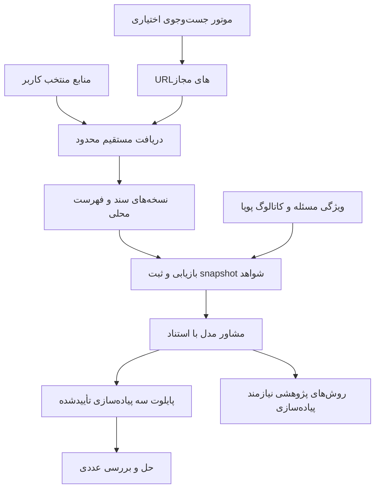

# سند توسعه کتابخانه منابع SolverScout نسخه ۲٫۱

| مشخصه | مقدار |
| --- | --- |
| نسخهٔ سند | `2.1` |
| تاریخ تدوین | `2026-11-10` |
| وضعیت | آمادهٔ بازبینی و مبنای پیاده‌سازی بعدی |
| مبنای کد | شاخهٔ `dev` در commit `3a4f46d` |
| مخاطب | توسعه‌دهنده، عامل پیاده‌سازی و ارزیاب |
| هدف | اختیاری‌شدن Tavily، دریافت مستقیم منابع، کتابخانهٔ محلی و به‌روزرسانی قابل پیگیری |
| مرجع قرارداد قبلی | [سند نسخهٔ ۲](P_MC_Web_Research_Optimization_Development_Spec_v2.0.md) |

## ۱ هدف و نتیجه قابل تحویل

SolverScout باید بتواند شواهد الگوریتم‌ها را از اسناد ذخیره‌شده روی رایانه بازیابی کند و منابع منتخب کاربر را مستقیماً به‌روزرسانی کند. Tavily یکی از مسیرهای اختیاری کشف صفحه خواهد بود. نبود کلید یا دسترسی به آن، پیش‌شرط مسیر کتابخانه یا دریافت مستقیم را نقض نمی‌کند.

کاربر باید بتواند منبع ثبت کند، محتوا را دریافت کند، در کتابخانه جست‌وجو کند، زمان آخرین بررسی موفق را ببیند و مسئله را با استناد به نسخهٔ مشخص اسناد حل کند. اضافه‌شدن روش پژوهشی از محتوای منابع انجام می‌شود. ورود آن به اجرای عددی به پیاده‌سازی سازگار و qualification موجود وابسته است.

UI، API، ذخیره‌سازی، استخراج، جست‌وجوی اسناد و محاسبات عددی محلی اجرا می‌شوند. مدل زبانی همچنان از API استفاده می‌کند. در این سند «بازیابی محلی» به صفر بودن درخواست شبکهٔ پژوهش برای آن Job اشاره دارد و دسترسی API مدل جداگانه سنجیده می‌شود.

واژهٔ «باید» الزام پذیرش است. این سند قرارداد توسعه است و وضعیت اجرای قابلیت‌ها در گزارش تحویل ثبت خواهد شد.

## ۲ مسئله موجود و مبنای تصمیم

در آزمون زندهٔ ثبت‌شده، دسترسی Tavily ابتدا timeout و سپس پاسخ HTML با HTTP 403 داشت. پس از تغییر اتصال، پژوهش با دو جست‌وجو، ده نتیجه، چهار سند و هشت passage کامل شد. مشاور به‌دلیل نبود شواهد مرتبط برای سه پیاده‌سازی موجود متوقف شد. این شواهد دو نیاز مستقل را نشان می‌دهند. بازیابی باید چند مسیر داشته باشد و پرس‌وجو باید هم کشف روش تازه و هم یافتن شواهد برای کاتالوگ اجرایی را پوشش دهد. [گزارش آزمون واقعی](../TEST_RESULTS_V2.md)

| وضعیت موجود | تصمیم این توسعه |
| --- | --- |
| `SearchProfile.provider_id` و endpoint به Tavily محدودند | پیکربندی موتور جست‌وجو اختیاری و مستقل از منبع |
| `ResearchGateway` امکان تزریق adapter دارد | استفاده از همین نقطهٔ اتصال با انتخاب صریح adapter |
| حالت `live` به کلید جست‌وجو نیاز دارد | پیش‌شرط اختصاصی برای هر مسیر |
| `source_documents` به Job تعلق دارد | کتابخانهٔ مستقل با نسخه‌های سند و ارجاع Job |
| کلید کش شامل عبارت ثابت `tavily` است | هویت محتوا مستقل از روش کشف، همراه با سابقهٔ کشف |
| `PlannerContext` خانواده‌های قابل اجرا را دریافت نمی‌کند | افزودن راهنمای پویا از کارت‌های کاتالوگ |
| `cache_only` از اسناد اجراهای قبلی استفاده می‌کند | حفظ معنای قبلی و افزودن کتابخانهٔ قابل تغذیه و به‌روزرسانی |

## ۳ دامنه انتشار نخست

### ۳٫۱ قابلیت‌های الزامی

- مدیریت منابع مجاز با hostname و مسیرهای مشخص، همسو با `SourcePolicy` فعلی.
- دریافت مستقیم از URLهای آغازین، لینک‌های همان منبع و sitemapهای ثبت‌شده.
- پشتیبانی HTML، متن ساده و PDF دارای متن با استخراج‌کنندهٔ محدود فعلی.
- کتابخانهٔ مستقل، جست‌وجوی تمام‌متن محلی و نمایش منشأ هر قطعهٔ شاهد.
- به‌روزرسانی دستی یک یا چند منبع با پیشرفت، لغو، سقف مصرف و نتیجهٔ ثبت‌شده.
- تشخیص تغییر محتوا، ثبت مشاهدهٔ تازه و حفظ آخرین نسخهٔ سالم هنگام شکست دریافت.
- مسیر اختیاری Tavily با تنظیمات، کلید و آزمون اتصال اختصاصی.
- برنامه‌ریز و انتخاب passage آگاه از کاتالوگ، با ثبت روش‌های تازهٔ فاقد اجرای آماده.
- snapshot اسناد و شواهد برای هر Job، مهاجرت سازگار و گزارش قابل بازخوانی.

### ۳٫۲ توسعه‌های بعدی

اتصال اختصاصی OpenAlex، arXiv و GitHub API، SearXNG، موتور embedding، OCR، مرورگر سایت‌های JavaScript، همگام‌سازی ابری، زمان‌بندی خودکار و دریافت منابع نیازمند ورود در انتشار بعدی بررسی می‌شوند. در انتشار نخست، به‌روزرسانی با اقدام کاربر در UI یا API آغاز می‌شود.

تولید یا نصب خودکار کد الگوریتم از صفحه یا مقاله خارج از دامنه است. افزودن منبع، افزودن موتور جست‌وجو و افزودن پیاده‌سازی عددی سه عملیات مستقل با اثر قابل مشاهده‌اند.

## ۴ قرارداد نسخه‌ها و سازگاری

| قرارداد | تصمیم |
| --- | --- |
| `policy_version=1.0` و `2.0` | پردازش و گزارش با معنای موجود |
| policy و research envelope جدید | `2.1` با validator و dispatch صریح |
| `ProblemInput` و DSL | نسخهٔ `1.0` |
| Trial، solver config و قواعد پایلوت | قرارداد عددی `2.0` |
| context و prompt پژوهش جدید | `research_planner.v2.1` و `advisor.v2.1` |
| انتخاب passage جدید | `passage_selection_v2.1` |
| گزارش Job جدید | envelope نسخهٔ `2.1` با اجزای عددی نسخه‌دار |
| schema پایگاه SQLite | migration بعدی از عدد فعلی `2` به `3` |

بررسی‌های مستقیم `policy_version == "2.0"` در ایجاد Job، worker، API پژوهش، بودجهٔ LLM، ذخیره‌سازی گزارش و UI باید با dispatch نسخه‌دار پوشش داده شوند. تغییر عدد نسخه بدون آزمون مسیر عادی هر سه نسخه کافی نیست.

محدودهٔ عددی نسخهٔ ۲، حسابداری FE، سه نامزد و سه تکرار پایلوت، آرشیو جواب، دو بررسی نهایی و وضعیت `not_certified` مبنا هستند. هیچ سند یا مدل زبانی اجازهٔ افزایش بودجه یا تغییر دامنهٔ مسئله را ندارد.

## ۵ تجربه کاربر و مسیرهای پژوهش

سه مسیر در مرحلهٔ انتخاب روش نمایش داده شوند. پیش‌فرض Job جدید نسخهٔ ۲٫۱، «کتابخانهٔ محلی» است. در کتابخانهٔ خالی، UI کاربر را به ثبت منبع و به‌روزرسانی هدایت کند.

| `retrieval_mode` | عنوان UI | عملیات پژوهش | پیش‌شرط |
| --- | --- | --- | --- |
| `local_only` | کتابخانهٔ محلی | جست‌وجو در نسخه‌های واجد شرایط ذخیره‌شده | اسناد واجد شرایط و اتصال لازم مدل |
| `direct_refresh` | به‌روزرسانی منابع و حل | دریافت مستقیم منابع منتخب، سپس بازیابی محلی | ثبت URLهای مجاز و قابلیت دریافت مستقیم |
| `web_search` | کشف وب با موتور انتخابی | جست‌وجوی موتور، دریافت صفحات مجاز و بازیابی | موتور فعال و پیش‌شرط همان adapter |

در دو مسیر نخست، درخواست به Tavily و بررسی کلید آن صفر است. خاموش‌کردن موتور جست‌وجو موجب غیرفعال‌شدن کتابخانه یا دریافت مستقیم نمی‌شود. مسیر `web_search` در این انتشار فقط adapter موجود Tavily را دارد، اما قرارداد افزودن موتور دیگر را مجاز می‌کند.

سیاست انتخاب مستند نسخهٔ ۲٫۱ با ID جدید `evidence_research_then_pilot` تعریف شود و `retrieval_mode` زیرمجموعهٔ تنظیمات آن باشد. مسیرهای بدون پژوهش کاتالوگ می‌توانند از envelope فعلی نسخهٔ ۲ استفاده کنند. مقادیر تازه نباید به معنای `web_research_then_pilot` قدیمی تحمیل شوند.

تنظیم `on_research_failure` همان دو انتخاب `stop` و `continue_with_catalog` را دارد و پیش‌فرض `stop` است. مسیر مؤثر و دلیل تغییر مسیر در گزارش ثبت شوند. تغییر موتور، استفاده از نسخهٔ قدیمی‌تر یا ادامهٔ کاتالوگ به سیاست ثبت‌شدهٔ قبل از اجرا نیاز دارد.

درخواست نسخهٔ ۲٫۱ علاوه بر ورودی و بودجهٔ عددی، `retrieval_mode`، ارجاع revision منابع، `max_evidence_age_hours`، `stale_evidence_policy` و `on_research_failure` را دارد. `search_provider_ref` فقط در `web_search` لازم و در دو مسیر دیگر تهی است. `sync_limits` فقط در `direct_refresh` لازم است. backend snapshot کامل را از این ارجاع‌ها می‌سازد. تنظیم پیش‌فرض UI جای snapshot هر Job را نمی‌گیرد.

## ۶ معماری و مرز مسئولیت‌ها

`SourcePolicy`، `PinnedTransport`، `DocumentFetcher`، استخراج‌کننده و سازوکار artifact موجود تا حد امکان استفاده شوند. منبع، قاعدهٔ مجازبودن و محتوای قابل دریافت را مشخص می‌کند. adapter جست‌وجو فقط URLهای نامزد کشف می‌کند. کتابخانه محتوا و نسخه‌ها را مستقل از adapter نگه می‌دارد.

`SourceSynchronizer` مالک عملیات به‌روزرسانی و دفتر مصرف آن است. `LibraryRetriever` فقط از snapshot کتابخانه بازیابی می‌کند. `ResearchGateway` مسیر انتخاب‌شده، بودجه و ثبت شواهد Job را هماهنگ می‌کند. هیچ‌کدام از این اجزا کد الگوریتم دریافتی را اجرا نمی‌کنند.

## ۷ ثبت منبع و دریافت مستقیم

`LibrarySourceConfig` شامل `source_id`، revision تنظیمات، ارجاع `SourceRule`، `seed_urls`، `sitemap_urls`، `follow_links`، `crawl_depth` و سقف‌های دریافت است. قاعدهٔ hostname و مسیر از مخزن فعلی منابع خوانده شود و نسخهٔ کامل آن هنگام sync و Job ثبت شود. فهرست مجاز موازی با قواعد ناسازگار ساخته نشود.

URLهای آغازین سند باید مجاز باشند. sitemapهای ثبت‌شده می‌توانند در مسیر کنترلی دیگری از همان hostname باشند و UI این مسیر را هنگام ذخیره نشان دهد. مجوز sitemap فقط برای خواندن فهرست URLهاست. هر URL سند همچنان باید از مسیر محتوای مجاز عبور کند. sitemap فرزند تنها وقتی خوانده شود که URL آن در `sitemap_urls` ثبت شده باشد. URLهای معرفی‌شده در robots یا صفحه به‌خودی‌خود مجوز تازه ایجاد نمی‌کنند.

ترتیب دریافت قطعی باشد. seedها در ترتیب ثبت‌شده بررسی شوند، سپس sitemapهای ثبت‌شده و سپس لینک‌های داخلی با پیمایش breadth-first و tie-break بر URL canonical. عمق seed صفر است. URL تکراری در یک SyncRun دوباره ارسال نشود. پیش از هر تماس، محدودیت شبکه، بودجه، لغو و وضعیت فعال منبع بررسی شود.

XML باید بدون entity خارجی و DTD پردازش شود. sitemapهای فشرده نیز پس از بازشدن در سقف اندازه محاسبه شوند. لینک‌های دانلود نامرتبط، fragment، redirect، path مبهم و query طبق قواعد نسخه‌دار `SourcePolicy` عادی‌سازی یا رد شوند. robots، اعتبار TLS، بررسی IP عمومی و کنترل هر redirect طبق مسیر فعلی اجرا شوند.

تغییر hostname یا مسیرهای مجاز، revision جدید می‌سازد. تنظیمات دریافت قدیمی تا اعتبارسنجی مجدد وضعیت `needs_review` می‌گیرند. حذف یا غیرفعال‌کردن منبع آن را از sync و snapshotهای جدید حذف می‌کند. درخواست شبکهٔ تازه برای منبع لغوشده مجاز نیست. Jobی که شواهدش قبلاً تثبیت شده می‌تواند از همان شواهد ثبت‌شده به پایان برسد.

پیش از هر دریافت و تثبیت شاهد، مجوز مؤثر اشتراک scope منجمد اجرا با محدودیت‌های فعلی منبع باشد. گسترش بعدی مجوز دامنهٔ Job فعال را وسیع نکند. revision هر دو قاعده در snapshot ثبت شود. تغییر تنظیمات منبع پیش از انتشار sync موجب `SOURCE_CONFIG_CHANGED` و کنارگذاشتن staging آن منبع شود.

## ۸ قراردادهای داده کتابخانه

| قرارداد | داده‌های لازم |
| --- | --- |
| `LibraryDocument` | `document_id`، URL canonical، ارجاع عضویت در منبع |
| `DocumentVersion` | `version_id`، hash بایت و متن، نسخهٔ parser، نوع محتوا، عنوان، زبان در صورت معلوم‌بودن، سطح متن، truncation، محل artifact |
| `FetchObservation` | `observation_id`، SyncRun، source revision، URL درخواستی و نهایی، redirectها، زمان، HTTP status، نتیجهٔ اعتبارسنجی، ارجاع نسخه |
| `SourceSyncRun` | فهرست منابع و revisionها، مالک مستقل یا Job، بودجهٔ کلی و هر منبع، وضعیت، lease، حسابداری، پوشش، خطاها و generation منتشرشده |
| `LibrarySnapshot` | generation کتابخانه، قواعد منابع، نسخه‌ها و observationهای منتخب، سیاست تازگی، نسخهٔ index و retrieval |
| `EvidencePassageV21` | ID شاهد، version و observation، offset آغاز و پایان، متن دقیق، روش انتخاب، source ID و URL |
| `DiscoveryRecord` | مسیر کشف مانند `direct_seed`، `sitemap`، `internal_link`، `tavily` یا `legacy_import` همراه با query یا والد |

متن یکسان می‌تواند در سطح artifact با hash مشترک ذخیره شود. عضویت منبع، URL و سابقهٔ دریافت هر سند مستقل ثبت شوند. دریافت از دو مسیر نباید اعتبار یا تاریخچهٔ یکی را به دیگری نسبت دهد. هویت نسخه از URL canonical، hash بایت، hash متن و parser version ساخته شود. مشاهدهٔ جدید می‌تواند به نسخهٔ قبلی اشاره کند.

جدول‌های جدید کتابخانه از `source_documents.job_id` مستقل باشند. نام‌های پیشنهادی `library_documents`، `library_versions`، `library_observations`، `library_memberships`، `source_sync_runs`، `source_sync_invocations`، `library_generations` و `job_library_snapshots` هستند. جدول FTS دادهٔ مشتق‌شده است و باید از نسخه‌های معتبر قابل بازسازی باشد.

فایل خام و متن در artifact store با نوشتن موقت و atomic rename ذخیره شوند. تنها بعد از تکمیل فایل و کنترل hash، رکورد قابل جست‌وجو منتشر شود. کلید API، header احراز هویت و token داخلی در هیچ رکورد محتوایی، index یا export قرار نگیرند.

## ۹ به‌روزرسانی و تازگی

| پاسخ یا رویداد | رفتار |
| --- | --- |
| HTTP 200 با محتوای تازه | ساخت نسخه و observation جدید |
| HTTP 200 با همان بایت و parser | استفاده از نسخهٔ موجود و ثبت observation تازه |
| HTTP 304 | تأیید نسخهٔ قبلی و ثبت زمان بررسی موفق تازه |
| HTTP 304 با artifact مفقود یا خراب | ثبت `LIBRARY_ARTIFACT_MISSING` و پرهیز از اعلام نسخهٔ معتبر |
| timeout، 403، 429 یا خطای parser | حفظ آخرین نسخهٔ سالم و ثبت شکست همان تلاش |
| HTTP 404 یا 410 | ثبت `remote_unavailable` برای URL، حفظ نسخهٔ تاریخی |
| نبود URL در پیمایش محدود یا sitemap جدید | ثبت پوشش پیمایش، بدون حذف خودکار سند |
| تغییر parser | تولید نسخهٔ مشتق‌شده با parser جدید و حفظ نسخهٔ پیشین |

زمان‌های `last_attempt_at`، `last_successful_validation_at` و تاریخ انتشار اعلام‌شدهٔ منبع مستقل باشند. شکست دریافت زمان تازگی را جلو نمی‌برد. تازگی با observation موفق دارای بایت قابل استفاده سنجیده می‌شود. `Last-Modified` و تاریخ مقاله به‌تنهایی تأیید زمان دسترسی نیستند.

سیاست `max_evidence_age_hours` پیش‌فرض ۱۶۸ ساعت و بازهٔ مجاز ۱ تا ۸۷۶۰ ساعت دارد. استفاده از شاهد قدیمی‌تر فقط با `stale_evidence_policy=allow_with_warning` ثبت‌شده پیش از Job مجاز است. پیش‌فرض `reject` است. اسناد `remote_unavailable` نیز فقط در این انتخاب صریح قابل استفاده‌اند. دادهٔ بدون زمان معتبر در گروه stale قرار می‌گیرد.

نتیجهٔ sync، تضمین پوشش کل وب‌سایت نیست. تعداد URLهای بررسی‌شده، موارد کنارگذاشته‌شده و علت توقف باید نشان داده شود. UI آخرین بررسی موفق و آخرین تلاش ناموفق را کنار هم نمایش دهد.

## ۱۰ تراکنش، هم‌زمانی و بازیابی شکست

ثبت به‌روزرسانی با `Idempotency-Key` و hash تنظیمات انجام شود. تکرار کلید با payload یکسان همان SyncRun را برگرداند و payload متفاوت خطای conflict بدهد. هر SyncRun مالک یک درخواست چندمنبعی با بودجهٔ کلی است و وضعیت و شمارندهٔ هر منبع را جدا نگه می‌دارد. invocationها هم Run ID و هم source ID دارند.

رزرو مالکیت همهٔ source IDهای درخواست در یک تراکنش انجام شود. هر منبع حداکثر در یک SyncRun غیرنهایی حضور داشته باشد. درخواست با کلید تازه و منبع مشترک، HTTP 409 با کد `SOURCE_SYNC_IN_PROGRESS` و شناسهٔ اجرای موجود بگیرد. Job به sync مستقل کاربر متصل نشود و آن را لغو نکند. کاربر پس از پایان اجرای موجود می‌تواند دوباره درخواست دهد.

در انتشار نخست، یک worker دریافت مستقیم، صف منابع را ترتیبی اجرا کند. پیش از تماس خارجی، invocation و سهم مصرف در تراکنش reserve شوند. پس از پاسخ، وضعیت، زمان و حجم settle شوند. retry خودکار HTTP خاموش است. درخواست timeout یا با نتیجهٔ نامعلوم همچنان سهم درخواست مصرف می‌کند.

SyncRun وضعیت‌های `queued`، `running`، `completed`، `partial`، `failed`، `cancelled` و `interrupted` دارد. مالکیت worker با lease و heartbeat ثبت شود. پس از مرگ worker، reservation نامعلوم تکرار نشود. اجرای قطع‌شده `interrupted` شود و کاربر با اقدام تازه SyncRun جدید بسازد.

نسخه‌های آماده در staging باقی بمانند و در پایان sync یک تراکنش، membership، observationهای قابل استفاده، index و generation را منتشر کند. در وضعیت `partial`، نسخه‌های موفق با پرچم پوشش ناقص منتشر شوند. در `cancelled` یا `interrupted`، staging منتشر نشود. شکست commit نباید فایل ناقص یا رکورد index بدون نسخه ایجاد کند.

مشاهدهٔ موفق شامل HTTP 200 قابل استفاده یا HTTP 304 با artifact سالم است. با دست‌کم یک مشاهدهٔ موفق و پایان کل صف مجاز بدون خطا، نتیجه `completed` است. وجود مشاهدهٔ موفق همراه با شکست یا پوشش ناتمام، نتیجه `partial` می‌دهد. وقتی هیچ مشاهدهٔ موفقی وجود ندارد نتیجه `failed` است. پایان سقف با دادهٔ موفق `partial` و بدون دادهٔ موفق `failed` ثبت شود. اسناد سالم پیشین در هر حالت حفظ شوند.

بازیابی محلی یک generation سازگار را در تراکنش خواندن انتخاب کند. پس از تثبیت `LibrarySnapshot` و passageها، refresh هم‌زمان محتوای Job را تغییر ندهد. پاک‌سازی فقط artifactهای بی‌ارجاع را پس از بررسی وابستگی حذف کند. نسخهٔ مورد استناد گزارش‌ها تا وجود آن گزارش حفظ شود.

خطای کمبود فضای دیسک باید با `LIBRARY_STORAGE_FULL` ثبت شود و نسخهٔ سالم قبلی را حفظ کند. پیش‌فرض سهم فضای artifact کتابخانه ۲ GiB و حداکثر قابل تنظیم ۱۰ GiB است. فایل‌های staging و نسخه‌های تاریخی نیز در این سهم محاسبه شوند. UI استفادهٔ فعلی و گزینهٔ پاک‌سازی داده‌های بی‌ارجاع را نشان دهد.

## ۱۱ سقف‌ها و حسابداری

سقف‌های زیر برای انتشار نخست الزام‌آورند. مقدار پیش‌فرض در UI قابل کاهش و تا حداکثر جدول قابل افزایش است.

| بودجه | پیش‌فرض | حداکثر |
| --- | --- | --- |
| منابع در یک درخواست به‌روزرسانی | ۵ | ۱۰ |
| seed در هر منبع | ۵ | ۲۰ |
| sitemap ثبت‌شده در هر منبع | ۱ | ۳ |
| عمق دنبال‌کردن لینک | ۱ | ۲ |
| URL کشف‌شده در هر منبع | ۲۰۰ | ۱۰۰۰ |
| تلاش دریافت سند در هر منبع | ۳۰ | ۱۰۰ |
| کل HTTP هر منبع، شامل robots و redirect | ۱۲۰ | ۴۰۰ |
| redirect هر دریافت | ۳ | ۳ |
| زمان فعال هر منبع | ۱۲۰ ثانیه | ۳۰۰ ثانیه |
| زمان فعال کل درخواست به‌روزرسانی | ۳۰۰ ثانیه | ۶۰۰ ثانیه |
| زمان هر تماس | ۲۰ ثانیه | ۳۰ ثانیه |
| بایت بازشدهٔ هر سند | ۵ MiB | ۱۰ MiB |
| بایت بازشدهٔ هر sitemap | ۲ MiB | ۵ MiB |
| کل بایت بازشدهٔ درخواست به‌روزرسانی | ۵۰ MiB | ۱۰۰ MiB |
| متن ذخیره‌شدهٔ هر سند | ۱۰۰٬۰۰۰ نویسه | ۲۰۰٬۰۰۰ نویسه |
| سند منتخب برای مشاور | ۶ | ۶ |
| passage منتخب | ۱۲ | ۱۲ |
| طول هر passage | ۱۵۰۰ نویسه | ۱۵۰۰ نویسه |
| کل passageهای ارسالی | ۱۸٬۰۰۰ نویسه | ۱۸٬۰۰۰ نویسه |

برای `web_search`، سقف موتور و دریافت همان سه تلاش جست‌وجو، شش سند و ۲۷ درخواست HTTP نسخهٔ ۲ است. این مسیر crawl آزاد را هم‌زمان اجرا نمی‌کند. در `direct_refresh` حداکثر یک درخواست به‌روزرسانی به Job متصل می‌شود و مصرف آن علاوه بر گزارش sync در گزارش Job نیز با همان ID ارجاع داده می‌شود. یک درخواست در جمع مصرف دوبار شمرده نشود.

دفتر sync از ledger فعلی پژوهش مستقل است. عملیات FTS و خواندن artifact صفر HTTP مصرف می‌کند. برای تماس خارجی interrupted، حجم دریافت نامعلوم با سقف رزروشده محاسبه و به‌عنوان unknown گزارش شود. timeout هر فعالیت از زمان باقی‌مانده بیشتر نباشد و زمان cleanup جدا ثبت شود.

در v2.1 سهم‌های LLM همان چهار نقش با حداکثر دو تماس هر نقش و هشت تماس کل هستند. برنامه‌ریزی دریافت مستقیمِ URLهای ثبت‌شده به تماس اضافی مدل نیاز ندارد. هزینهٔ نامعلوم Tavily یا مدل مقدار `null` دارد.

## ۱۲ جست‌وجوی محلی و انتخاب شواهد

انتخاب اولیه SQLite FTS5 است تا index کنار داده‌های فعلی نگهداری شود. قابلیت FTS5 با آزمون ساخت جدول موقت در doctor بررسی شود. نبود قابلیت، پیام `LOCAL_INDEX_UNAVAILABLE` بدهد. [مستندات SQLite FTS5](https://www.sqlite.org/fts5.html)

متن ذخیره‌شده برای استناد دست‌نخورده بماند و متن عادی‌سازی‌شدهٔ index جدا تولید شود. NFKC و یکسان‌سازی حروف فارسی در جست‌وجو مجازند، اما offsetها روی متن اصلی نسخه محاسبه شوند. SQL و عبارت MATCH از توکن‌های اعتبارسنجی‌شده ساخته شوند. خروجی LLM به‌صورت دستور SQL یا عبارت FTS دلخواه اجرا نشود.

offset بر حسب code point یونیکد، با آغاز شامل و پایان غیرشامل است. backend باید برابری `text[start:end]` با متن شاهد را پیش از ارسال به مدل و export بررسی کند. تبدیل offset برای نمایش مرورگر مسئولیت UI است.

برای هر query حداکثر ۳۲ توکن یکتای عادی‌سازی‌شده انتخاب شود. توکن‌ها پس از escape به‌صورت عبارت‌های نقل‌قول‌شده با عملگر OR ترکیب شوند. نام‌های چندکلمه‌ای معتبر کارت می‌توانند عبارت مستقل باشند. ترتیب انتخاب توکن‌ها، وزن عنوان و متن و نسخهٔ tokenizer در `retrieval_version` ثبت شود. تغییر این قواعد باید fixture رتبه‌بندی و نسخهٔ retrieval را به‌روزرسانی کند.

پیش از رتبه‌بندی، source membership، snapshot، تازگی، وضعیت artifact و سطح متن فیلتر شوند. ترتیب نسخه‌دار بازیابی از BM25 و tie-break بر URL canonical و version ID استفاده کند. از هر query حداکثر بیست سند اولیه و در مجموع شش سند انتخاب شود. ترکیب queryها نوبتی باشد و سند تکراری حذف شود.

`passage_selection_v2.1` دو جریان دارد. جریان `implementation_evidence` ابتدا قطعه‌های دارای تطابق نام یا alias معتبر کارت را انتخاب می‌کند و سپس تعداد keyword مشترک و offset را معیار قرار می‌دهد. جریان `method_discovery` بر keywordهای ویژگی مسئله تکیه دارد. از هر سند حداکثر دو قطعه انتخاب شود و ترتیب نوبتی queryها و منابع در سقف دوازده قطعه رعایت شود. متن بلند در مرزهای حداکثر ۱۵۰۰ نویسه قطعه‌بندی شود و محل truncation ثبت شود.

aliasها از metadata و نام کلاس‌ها یا نام‌های بازبینی‌شدهٔ کارت ساخته شوند. alias تولیدشدهٔ تأییدنشدهٔ مدل برای اثبات تطابق استفاده نشود. کیفیت نام و کوتاه‌نویسی مبهم باید در fixtureها پوشش داده شود. قواعد v2.0 برای بازپخش گزارش‌های قدیمی در دسترس بمانند.

## ۱۳ برنامه‌ریز و ارتباط با کاتالوگ

`PlannerContextV21` شامل ویژگی‌های مجاز مسئله، منابع، مسیر پژوهش، حداکثر سه query و حداکثر بیست کارت کوتاه سازگار باشد. هر کارت کوتاه ID پیاده‌سازی، خانواده، نام و alias معتبر دارد. نام خانواده‌ها از کاتالوگ frozen همان Job می‌آید.

برنامهٔ خروجی این سیاست بین دو تا سه query دارد. حداقل یک query از نوع `implementation_evidence` و یک query از نوع `method_discovery` لازم است. query اول می‌تواند چند خانوادهٔ قابل اجرا را پوشش دهد. backend IDهای منابع و کارت‌های هدف را اعتبارسنجی می‌کند. تابع هدف، دادهٔ حساس و جواب مرجع بنچمارک وارد جست‌وجوی خارجی نشوند.

`AdvisorContextV21` به‌جای وابستگی معنایی به `require_web`، فیلد `require_evidence` و ارجاع snapshot و شواهد محلی دارد. validator باید referenceها، متن، سطح ادعا و نگاشت نسخهٔ روش را بررسی کند. وجود نام خانواده فقط ادعای family-level را مجاز می‌کند. method-level به شاهد مشخص همان variant نیاز دارد.

وجود کاتالوگ به‌تنهایی citation نمی‌سازد. با کمتر از سه گزینهٔ مستند، مشاور `insufficient_evidence` می‌دهد. سیاست شکست Job تعیین می‌کند اجرا متوقف شود یا با برچسب صریح به مشاور کاتالوگ ادامه دهد.

روش تازهٔ ناموجود در کاتالوگ به‌صورت `research_only` با نام، شواهد و دلیل عدم نگاشت ثبت شود. انتخاب آن برای پایلوت تا وجود پیاده‌سازی و پیکربندی qualified مجاز نیست. افزودن کتابخانه یا روش تازه مستلزم تغییر فهرست ثابت نام الگوریتم‌ها در برنامه‌ریز نباشد.

## ۱۴ ترتیب Job و ثبت snapshot

۱. API سیاست، منبع، profile مدل و تنظیمات مسیر را از revisionهای سروری تثبیت کند. preflight تنظیمات هر مسیر پیش از مصرف FE انجام شود.

۲. ورودی مسئله صورت‌بندی و اعتبارسنجی شود. در `direct_refresh`، sync محدود پیش از نمونه‌برداری عددی آغاز شود. وضعیت `refreshing_sources` با لینک SyncRun در UI نمایش داده شود.

۳. profile عددی مطابق قرارداد موجود ساخته شود. در مسیر پژوهش، planner نسخهٔ ۲٫۱ برنامه تولید کند. در `web_search` موتور منتخب و fetch مجاز با ledger همان Job اجرا شوند.

۴. پس از تکمیل دریافت مورد نیاز، بازیابی در یک تراکنش از generation مشخص انجام شود. snapshot نسخه‌های منتخب، observationها و متن passage پیش از فراخوانی advisor ثبت شود. در `local_only` این مرحله هیچ درخواست پژوهشی شبکه ندارد.

در `web_search` مجموعهٔ اسناد واجد انتخاب فقط نسخه‌های دریافت‌شده یا revalidated همان پژوهش است. بازیابی از کل کتابخانه به نام نتیجهٔ زنده انجام نشود. در دو مسیر دیگر، اسناد مجاز کتابخانه با سیاست تازگی انتخاب شوند و در `direct_refresh` ارتباط هر سند با SyncRun فعلی یا دریافت قبلی ثبت شود.

۵. مشاور، پایلوت، انتخاب، حل اصلی و verification با همان کنترل بودجه انجام شوند. گزارش، مسیر درخواستی و مؤثر، نسخه‌های اسناد و زمان بازیابی را نگه دارد.

تعطیلی منبع یا تغییر سیاست پیش از تثبیت شواهد باید در فیلتر جاری اعمال شود. انتظار برای اقدام کاربر به زمان فعال sync افزوده نشود. لغو Job هر sync متعلق به آن را نیز لغو کند. sync مستقل کاربر مالکیت و وضعیت مستقل دارد.

## ۱۵ خطاها و رفتار بازیابی

| کد | رفتار لازم |
| --- | --- |
| `LIBRARY_EMPTY` | هدایت به افزودن و به‌روزرسانی منبع، پیش از FE |
| `LIBRARY_EVIDENCE_STALE` | نمایش آخرین بررسی موفق و درخواست انتخاب صریح یا به‌روزرسانی |
| `LOCAL_INDEX_UNAVAILABLE` | راهنمای doctor یا بازسازی index، بدون تغییر خودکار مسیر |
| `LIBRARY_ARTIFACT_MISSING` | کنارگذاشتن نسخهٔ خراب و ثبت علت، حفظ گزارش تشخیصی |
| `SOURCE_CONFIG_CHANGED` | ثبت conflict و درخواست بارگذاری تنظیمات تازه |
| `SOURCE_SYNC_IN_PROGRESS` | نمایش اجرای موجود و انتظار تا پایان آن |
| `LIBRARY_STORAGE_FULL` | توقف نوشتن تازه، نمایش مصرف فضا و حفظ دادهٔ سالم |
| `SOURCE_NOT_ALLOWED` | رد URL و ثبت دلیل |
| `SOURCE_UNREACHABLE` و `SOURCE_PARSER_TIMEOUT` | حفظ نسخهٔ سالم و ادامهٔ صف در بودجه |
| `SYNC_BUDGET_EXHAUSTED` | پایان partial با ثبت پوشش و مصرف واقعی |
| `SEARCH_ACCESS_DENIED` | نمایش منع دسترسی، بدون درخواست تعویض کلید به‌عنوان علت قطعی |
| `SEARCH_AUTH_FAILED` و `SEARCH_RATE_LIMITED` | قواعد credential و Retry-After مسیر اختیاری جست‌وجو |
| `RESEARCH_EVIDENCE_INSUFFICIENT` | توقف یا fallback مطابق سیاست frozen |

کتابخانهٔ خالی و stale در `local_only` وضعیت `needs_configuration` می‌دهند. کاربر می‌تواند خارج از آن Job منابع را به‌روزرسانی کند و ادامه را بزند. چون snapshot شواهد هنوز ساخته نشده است، ادامه با همان تنظیمات frozen دوباره readiness را بررسی می‌کند. اگر نیاز به تغییر policy یا منابع باشد، Job تازه لازم است.

Job نهایی `failed` با همان ID دوباره پژوهش نمی‌کند. شکست دریافت در `direct_refresh` به‌خودی‌خود زمان اعتبار اسناد قدیمی را تغییر نمی‌دهد. شواهد قبلی تنها اگر طبق سیاست تازگی واجد شرایط باشند قابل انتخاب‌اند و شکست refresh در گزارش باقی می‌ماند.

## ۱۶ رابط کاربری

صفحهٔ «منابع و الگوریتم‌ها» بخش «کتابخانهٔ منابع» داشته باشد. هر منبع تعداد اسناد قابل استفاده، آخرین بررسی موفق، آخرین تلاش، خطا و دکمه‌های «به‌روزرسانی» و «مشاهدهٔ اسناد» داشته باشد. افزودن منبع، مسیرهای مجاز و محدودهٔ پیمایش را پیش از ذخیره روشن کند.

پیش‌نمایش به‌روزرسانی، سقف صفحات، زمان و حجم را نمایش دهد. پیشرفت باید از شمارنده‌های واقعی باشد. در پایان، تعداد جدید، تغییرکرده، بدون تغییر، ناموفق و پوشش ناقص دیده شود. کاربر بتواند متن ذخیره‌شده، URL، تاریخ اعتبار و هش نسخه را بازبینی کند.

در صفحهٔ تنظیمات، «موتور جست‌وجوی وب» انتخاب اختیاری با حالت «غیرفعال» داشته باشد. کلید Tavily فقط برای همان موتور درخواست شود. ذخیرهٔ کلید از سازوکار امن موجود استفاده کند. «کتابخانه آماده است» و «اتصال موتور آماده است» دو وضعیت مستقل‌اند.

در صفحهٔ نتیجه، منشأ شواهد با عنوان «کتابخانهٔ محلی»، «منابع مستقیم» یا «جست‌وجوی وب» و زمان بررسی نمایش داده شود. شاهد قدیمی، متن ناقص، چکیده و سند revalidated برچسب دقیق داشته باشند. خطای منبع، کمبود شواهد و خطای عددی پیام‌های جدا و اقدام مشخص داشته باشند.

## ۱۷ API و محل تغییرات

| endpoint پیشنهادی | مسئولیت |
| --- | --- |
| `GET /library/sources` | تنظیمات دریافت و وضعیت منابع مجاز فعلی |
| `PUT /library/sources/{source_id}` | تنظیم دریافت با `expected_revision` و اعتبارسنجی SourceRule |
| `POST /library/sync-runs` | ثبت sync محدود و idempotent |
| `GET /library/sync-runs/{id}` | وضعیت و مصرف واقعی |
| `POST /library/sync-runs/{id}/cancel` | لغو با نسخهٔ مورد انتظار |
| `GET /library/documents` | صفحه‌بندی و فیلتر منبع، تازگی و وضعیت |
| `GET /library/documents/{id}/versions` | تاریخچهٔ نسخه‌ها و مشاهده‌ها |
| `POST /library/search` | جست‌وجوی محلی محدود برای پیش‌نمایش UI |
| `GET/PUT /settings/retrieval` | مسیر پیش‌فرض و سیاست تازگی |
| `GET/PUT /settings/search-providers/{provider_id}` | تنظیم و وضعیت موتور اختیاری |
| `PUT/DELETE /settings/search-providers/{provider_id}/credential` | نوشتن یا حذف کلید بدون بازگرداندن مقدار |
| `POST /settings/search-providers/{provider_id}/test` | آزمون idempotent با مصرف ثبت‌شده |

APIها همان احراز محلی، validation، صفحه‌بندی و الگوی خطای موجود را استفاده کنند. endpointهای `/settings/search` فعلی نمای سازگار Tavily بمانند و دادهٔ موازی نسازند. افزودن provider از registry نصب‌شده انجام شود. endpoint دلخواهِ معرفی‌شده توسط مدل پذیرفته نشود.

تغییرات اصلی در `research/contracts.py`، `settings.py`، `gateway.py`، `evidence.py`، `storage.py`، `api/research_v2.py`، `llm/research_v2.py`، promptهای پژوهش، `workflow/catalog_v2.py` و صفحات منابع، تنظیمات و wizard است. ماژول‌های تازهٔ کتابخانه، sync و migration در کنار همین اجزا قرار بگیرند. گزارش‌ساز، worker، مرزهای نسخه در API و بسته‌بندی نیز باید نسخهٔ جدید را بشناسند.

## ۱۸ مهاجرت و نگهداری داده

مهاجرت هنگام توقف instance و پس از backup سازگار SQLite و artifacts انجام شود. Job ناتمام، lease فعال یا execution عددی نامعلوم باید پیش از migration در runtime قبلی تعیین تکلیف شود. migration بدون تغییر schema در صورت عدم تحقق این شرط متوقف شود.

ساخت schema ۳ و ثبت نسخهٔ migration تراکنشی باشد. پایگاه قدیمی و گزارش‌های آن بازنویسی معنایی نشوند. داده‌های Tavily و credential referenceهای موجود حفظ شوند. mode قدیمی `cache_only` به‌طور ضمنی معادل کتابخانهٔ جدید تفسیر نشود.

ورود اسناد قدیمی به کتابخانه یک عملیات مستقل، تکرارپذیر و قابل گزارش پس از migration باشد. artifactهای موجود از نظر hash و parser بررسی شوند و با provenance نوع `legacy_import` ثبت شوند. زمان دریافت و اعتبار قبلی حفظ شود. سند فاقد artifact یا زمان، تازه علامت نخورد. ورود تکراری نسخهٔ مضاعف نسازد.

backup کتابخانه شامل metadata، snapshotهای Job و artifactهای ارجاع‌شده است. index قابل بازسازی است. restore باید خوانایی گزارش‌های قدیمی، وجود فایل‌ها و یک جست‌وجوی نمونه را کنترل کند. rollback نرم‌افزار با backup و runtime سازگار انجام شود.

## ۱۹ مراحل توسعه

| مرحله | خروجی قابل بازبینی | شرط خروج |
| --- | --- | --- |
| L0 | baseline، فهرست dispatchها و fixture منابع | ثبت وضعیت واقعی و آزمون‌های موجود |
| L1 | قراردادهای ۲٫۱ و migration schema ۳ | validation، backup و replay نسخه‌های ۱ و ۲ |
| L2 | ذخیرهٔ مستقل نسخه، observation و generation | انتشار اتمیک و بازیابی crash |
| L3 | seed، لینک داخلی، sitemap و SyncRun | محدودیت منبع، حسابداری، لغو و به‌روزرسانی |
| L4 | FTS، تازگی، snapshot و passage نسخه‌دار | بازیابی بدون شبکه و ثبات شاهد |
| L5 | planner آگاه از کاتالوگ و adapter اختیاری | مسیر عادی بدون کلید Tavily و رفتار کمبود شواهد |
| L6 | UI منابع، پیشرفت و تنظیمات مسیر | کاربر بتواند منبع را ثبت، به‌روز و برای حل انتخاب کند |
| L7 | گزارش، export، آزمون زنده و تحویل | ماتریس پذیرش با نتیجه و محدودیت واقعی |

هر تغییر در branch مستقل `codex/...` انجام شود. پس از بررسی diff و ثبت آزمون مرتبط، commit همان branch به `dev` merge و `origin/dev` به‌روزرسانی شود. تکمیل مراحل به نتیجهٔ قابل مشاهده وابسته باشد.

## ۲۰ معیارهای پذیرش

| شناسه | سناریو | نتیجهٔ لازم |
| --- | --- | --- |
| LIB-01 | نصب تازه بدون کلید Tavily | ثبت منبع و دریافت مستقیم قابل استفاده باشد |
| LIB-02 | کلید Tavily نامعتبر و موتور غیرفعال | local و direct هیچ درخواست یا آزمون Tavily نداشته باشند |
| LIB-03 | دریافت seed و لینک داخلی | فقط URL مجاز، تا عمق و سقف ثبت‌شده |
| LIB-04 | sitemap در مسیر کنترلی و URL خارج منبع | فهرست خوانده شود، سند خارج scope رد شود |
| LIB-05 | XML مخرب، redirect خصوصی و DNS مختلط | درخواست غیرمجاز و entity خارجی اجرا نشوند |
| LIB-06 | 200 تازه، 200 یکسان و 304 | نسخه و observation با قواعد بخش ۹ ثبت شوند |
| LIB-07 | timeout، 403، 429 و شکست parser | نسخهٔ سالم حفظ و زمان تازگی جعل نشود |
| LIB-08 | 404، 410 یا sitemap ناقص | گزارش تاریخی حفظ و وضعیت منبع دقیق باشد |
| LIB-09 | ثبت هم‌زمان دو sync با منابع مشترک | رزرو اتمیک، conflict روشن و عدم لغو اجرای مستقل با لغو Job |
| LIB-10 | مرگ worker بعد از reserve یا نوشتن فایل | عدم replay تماس نامعلوم و index بدون artifact صفر |
| LIB-11 | لغو هنگام دریافت | تماس تازه آغاز نشود و staging منتشر نشود |
| LIB-12 | local با شبکهٔ پژوهش مسدود | بازیابی موفق و صفر HTTP پژوهشی، با LLM جداگانه |
| LIB-13 | کتابخانهٔ خالی، stale یا منبع خاموش | readiness و انتخاب صریح طبق قرارداد |
| LIB-14 | refresh، کاهش یا گسترش مجوز هم‌زمان | شاهد تثبیت‌شده ثابت، دریافت تازه محدود به اشتراک مجوزها |
| LIB-15 | query دارای دستور FTS یا SQL | اعتبارسنجی و بازیابی محدود، بدون اجرای دستور |
| LIB-16 | corpus با شواهد سه خانوادهٔ qualified | سه نامزد مستند، پایلوت و جواب عددی معتبر |
| LIB-17 | corpus نامرتبط یا فاقد سه گزینه | `insufficient_evidence` و رفتار policy، بدون citation ساختگی |
| LIB-18 | افزودن نام الگوریتم تازه به fixture | کشف `research_only` بدون ویرایش فهرست الگوریتم در کد |
| LIB-19 | تغییر نام، alias مبهم و variant نامشخص | تطابق family و method مطابق شواهد واقعی |
| LIB-20 | مهاجرت، import دوباره و restore | خوانایی گزارش v1/v2 و عدم نسخهٔ مضاعف |
| LIB-21 | UI پس از بازراه‌اندازی | تنظیمات، اسناد و کلید اختیاری امن باقی بمانند |
| LIB-22 | ثبت policyهای ۱٫۰، ۲٫۰ و ۲٫۱ از API عادی | worker، بودجه و گزارش مسیر صحیح داشته باشند |
| LIB-23 | اجرای واقعی روی اتصال بدون VPN | دسترسی هر منبع جدا ثبت شود و شرط Tavily وجود نداشته باشد |
| LIB-24 | Tavily فعال و واقعی با کتابخانهٔ قبلی | شاهد زنده فقط از دریافت همان پژوهش و خطاهای دسترسی دقیق |
| LIB-25 | سند بلند و نام روش پس از truncation | محدودیت متن آشکار و ادعای شاهد غایب ممنوع باشد |
| LIB-26 | export، کمبود فضا و پاک‌سازی | شاهد دقیق و بدون secret، حفظ دادهٔ سالم و نسخهٔ مورد استناد |

fixture ثابت برای بازیابی باید متن، hash، offsetهای مرجع و برچسب انسانیِ پشتیبانی از ادعا را داشته باشد. corpus مثبت و corpus نامرتبط جدا باشند. قبولی صرف وجود URL یا یک پاسخ مدل کافی نیست. آزمون زنده تعداد query، سند، شاهد و نامزد واقعی را گزارش کند و نتیجهٔ frozen را به‌عنوان نتیجهٔ زنده معرفی نکند.

## ۲۱ شروط تحویل و محدودیت عملیاتی

تحویل شامل کد، migration، راهنمای استفاده، نتیجهٔ آزمون‌ها و دست‌کم یک اجرای انتهابه‌انتهای مستند از مسیر کتابخانه و یک دریافت مستقیم واقعی باشد. نتیجهٔ آزمون هر سیستم‌عامل و منبع با یکی از وضعیت‌های `PASS`، `FAIL`، `BLOCKED` یا `NOT_TESTED` ثبت شود.

ادعای «دسترسی بدون VPN» فقط برای منابع و اتصال واقعاً آزموده‌شده مجاز است. دسترسی به هر سایت، کیفیت اسناد، وابستگی API مدل و کفایت شواهد سه نامزد جدا گزارش شوند. نبود دسترسی به یک منبع باید در UI قابل تشخیص باشد و استفاده از نسخهٔ قبلی تابع سیاست تازگی بماند.

معیار موفقیت این توسعه، اجرای مسیر کتابخانه و دریافت مستقیم بدون وابستگی اجباری Tavily، همراه با provenance قابل بازبینی و حفظ صحت انتخاب عددی است. وضعیت پیاده‌سازی و آزمون‌های این نسخه هنگام تدوین سند `NOT_TESTED` است.
